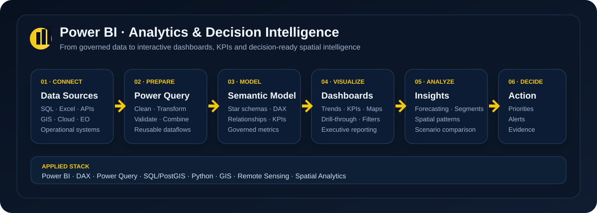
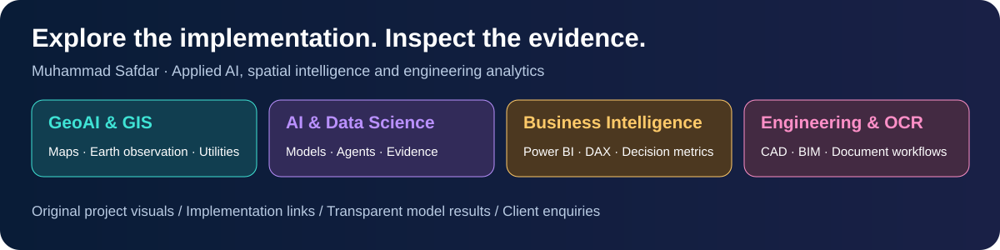
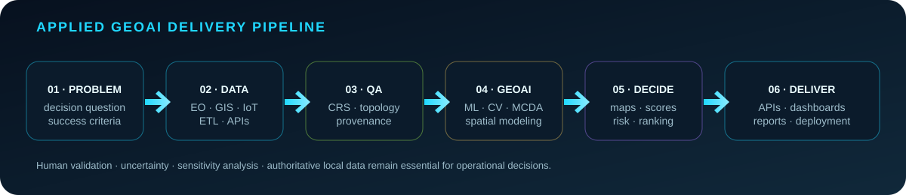
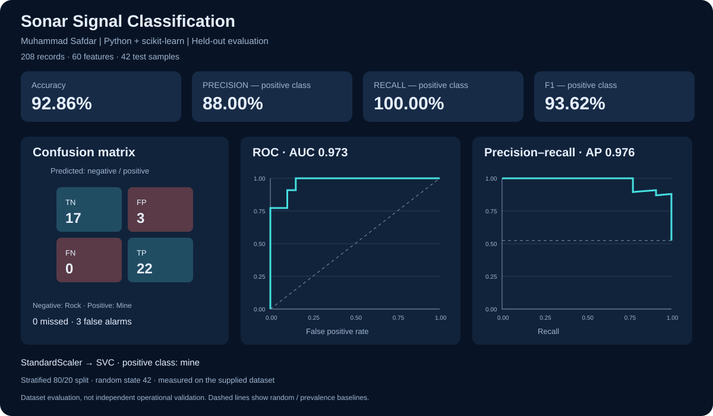
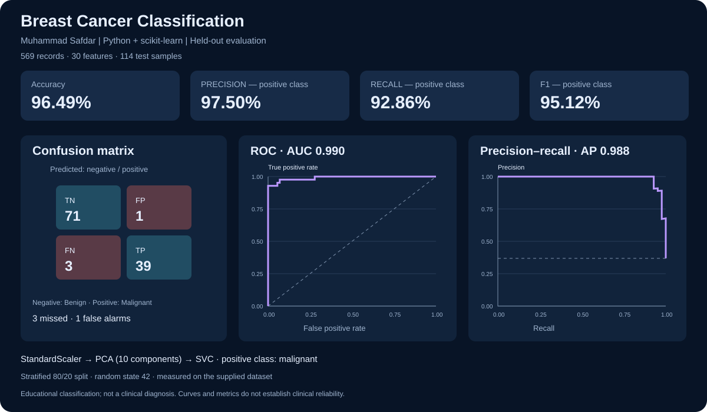
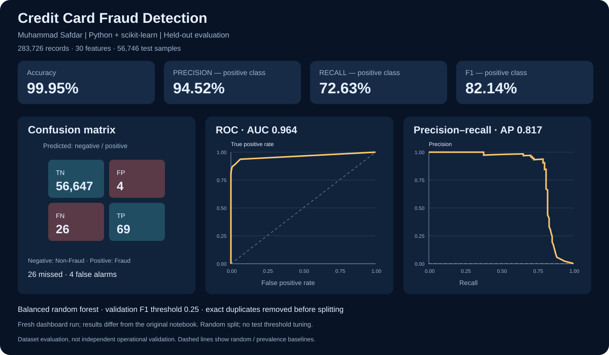

### Data Scientist · AI/ML Engineer · GeoAI & Enterprise GIS Specialist

I transform spatial, engineering and business data into validated analysis, production-minded applications and decision-ready intelligence.

**15+ years professional delivery · Pakistan & GCC experience · Open to global opportunities**

---

## What I deliver

| Capability | Applied work |
|---|---|
| **Data Science & AI** | Classification, regression, forecasting, computer vision, RAG, evaluation and explainable outputs |
| **Data Engineering & APIs** | ETL, SQL, validation, REST APIs, structured/vector data and deployment workflows |
| **GeoAI & Spatial Systems** | Enterprise GIS, remote sensing, urban planning, utilities, disaster intelligence and spatial decision support |
| **Engineering Intelligence** | CAD/BIM-to-GIS, MEP document analysis, GNSS/UAV and infrastructure information workflows |

> **Current focus:** trustworthy GeoAI, agent-ready spatial services, applied AI, data engineering and decision-support products.

---

## 📊 Power BI & Decision Intelligence

I use **Power BI, DAX and Power Query** to turn operational, business and geospatial data into governed metrics, interactive dashboards and decision-ready reporting.

**Power BI · DAX · Power Query · SQL/PostGIS · Python · GIS · Remote Sensing · Spatial Analytics**

---

<!-- PROJECT-GALLERY-START -->
## 🎨 Explore my projects

**Choose a workspace → explore the implementation → inspect the source or analysis → discuss your project.**

[**Browse searchable portfolio**](https://safdar404.github.io/) · [**Discuss a project on WhatsApp**](https://wa.me/923228792404) · [**Connect on LinkedIn**](https://www.linkedin.com/in/muhammad-safdar-88b27730)

Screenshots show existing interfaces; overview graphics illustrate project workflows. Demo access and sign-in requirements vary. Numerical highlights below describe the documented datasets or project scope, not independently verified operational performance.

<strong>🛰️ GeoAI &amp; GIS · 7 projects</strong>

 
<table>
<tr>
<td width="50%" valign="top">
 
<strong>Islamabad Feature Intelligence</strong> 
Original project interface / analysis image  
245,625 combined building references · Sentinel-2 screening  
ArcGIS · Python · GeoAI  
<a href="https://islamabad-feature-intelligence.safdarwatto7714.chatgpt.site"><strong>Open live dashboard</strong></a>
</td>
<td width="50%" valign="top">
 
<strong>GeoAI Resilience Intelligence Suite</strong> 
Original project interface / analysis image  
5 spatial programmes · Python research toolkit  
Python · GeoAI · GIS  
<a href="https://geoai-resilience-intelligence-suite.neat-grove-8624.chatgpt.site/"><strong>View project</strong></a> · <a href="https://github.com/safdar404/geoai-resilience-research-lab"><strong>Source</strong></a>
</td>
</tr>
<tr>
<td width="50%" valign="top">
 
<strong>GeoSentinel FloodOps</strong> 
Original project interface / analysis image  
An interactive global flood and water-intelligence demonstration linking geographic context, modeled exposure, incidents, missions and review-oriented recommendations.  
Leaflet · Flood intelligence · Human review  
<a href="https://safdar404.github.io/geosentinel-floodops/"><strong>View project</strong></a> · <a href="https://github.com/safdar404/safdar404.github.io/tree/main/geosentinel-floodops"><strong>Source</strong></a>
</td>
<td width="50%" valign="top">
 
<strong>Pakistan National Flood Intelligence</strong> 
Project overview graphic  
A national flood-planning dashboard combining dated disaster-impact context, river and reservoir summaries, district screening and phase-specific response views.  
React · TypeScript · GeoJSON  
<a href="https://pakistan-flood-intelligence-2026.neat-grove-8624.chatgpt.site/"><strong>View project</strong></a> · <a href="https://github.com/safdar404/Pakistan-National-Flood-Intelligence"><strong>Source</strong></a>
</td>
</tr>
<tr>
<td width="50%" valign="top">
 
<strong>GeoSentinel AI</strong> 
Original project interface / analysis image  
A geospatial decision-support dashboard demonstrating flood intelligence and municipal incident-management workflows, with the Nullah Lai and Margalla catchment as a featured context.  
Web GIS · Flood intelligence · Incident workflows  
<a href="https://geosentinel-ai-1.ai.studio/"><strong>Open live app</strong></a>
</td>
<td width="50%" valign="top">
 
<strong>GeoAI Site Intelligence Suite</strong> 
Project overview graphic  
3 spatial prototypes · Suitability, flood mitigation and solar  
Python · GeoAI · GIS  
<a href="https://safdar404.github.io/geoai-site-intelligence/"><strong>View suite</strong></a> · <a href="https://github.com/safdar404/safdar404.github.io/tree/main/geoai-site-intelligence"><strong>Source</strong></a>
</td>
</tr>
<tr>
<td width="50%" valign="top">
 
<strong>Pakistan Infrastructure GIS Command Centre</strong> 
Original project interface / analysis image  
A Punjab infrastructure GIS prototype bringing utility networks, asset condition, field verification, project progress and data-quality issues into one command dashboard.  
Infrastructure GIS · Utilities · Project monitoring  
<a href="https://pmu-pdp-infrastructure-gis.neat-grove-8624.chatgpt.site/"><strong>View project</strong></a>
</td>
<td width="50%"></td>
</tr>
</table>

<strong>🧠 AI &amp; Data Science · 5 projects</strong>

 
<table>
<tr>
<td width="50%" valign="top">
 
<strong>HIS AI Agentic Solutions</strong> 
Original project interface / analysis image  
An AI engineering and automation showcase connecting data, specialist agents, tools, validation and human approval in a clear workflow.  
Agentic workflows · Human review · GeoAI  
<a href="https://his-ai-agentic-solutions.lovable.app/"><strong>Open live app</strong></a>
</td>
<td width="50%" valign="top">
 
<strong>AI HealthAssist</strong> 
Original project interface / analysis image  
An educational healthcare decision-support prototype combining structured intake, symptom and vital-sign capture, clinical history, laboratory inputs and geographic context.  
Structured intake · Clinical calculators · Health GIS  
<a href="https://ai-healthassist.ai.studio/"><strong>View project</strong></a> · <a href="https://github.com/safdar404/HIS-AI-HealthAssist"><strong>Source</strong></a>
</td>
</tr>
<tr>
<td width="50%" valign="top">
 
<strong>Python &amp; AI Analytics Lab</strong> 
Original project interface / analysis image  
4 project workspaces · Model evaluation and source  
Pandas · scikit-learn · TensorFlow/Keras  
<a href="https://safdar404.github.io/python-ai-lab/"><strong>View project</strong></a> · <a href="https://github.com/safdar404/Fullstack-AI-BOOTCAMP-B-10"><strong>Source</strong></a>
</td>
<td width="50%" valign="top">
 
<strong>Prediction Studio</strong> 
Original project interface / analysis image  
A browser-based CSV analytics workspace with transparent calculations for heart-model audits, hospital capacity, healthcare inventory and device-event trends.  
CSV analytics · Model evaluation · Client-side JavaScript  
<a href="https://safdar404.github.io/prediction-studio/"><strong>View project</strong></a> · <a href="https://github.com/safdar404/Fullstack-AI-BOOTCAMP-B-10"><strong>Source</strong></a>
</td>
</tr>
<tr>
<td width="50%" valign="top">
 
<strong>LangChain RAG Document Assistant</strong> 
Project overview graphic  
A document-intelligence project demonstrating a traceable retrieval-augmented generation pipeline from document ingestion to source-aware answers.  
Python · LangChain · Vector search  
<a href="https://langchain-rag-document-assistant.neat-grove-8624.chatgpt.site/"><strong>View project</strong></a> · <a href="https://github.com/safdar404/LangChain-RAG-Application"><strong>Source</strong></a>
</td>
<td width="50%"></td>
</tr>
</table>

<strong>📊 Business Intelligence · 3 projects</strong>

 
<table>
<tr>
<td width="50%" valign="top">
 
<strong>Laptop Sales &amp; Pricing Intelligence</strong> 
Project overview graphic  
4,446 listings · Pricing, brands and data QA  
Power BI · DAX · Retail Analytics  
<a href="https://safdar404.github.io/laptop-intelligence/"><strong>Open dashboard</strong></a> · <a href="https://github.com/safdar404/safdar404.github.io/tree/main/laptop-intelligence"><strong>Model guide</strong></a>
</td>
<td width="50%" valign="top">
 
<strong>Customer Purchase Intelligence</strong> 
Project overview graphic  
2016–2019 analysis · Country, product and age bands  
Power BI · DAX · Customer Analytics  
<a href="https://safdar404.github.io/customer-purchase-intelligence/"><strong>Open dashboard</strong></a> · <a href="https://github.com/safdar404/safdar404.github.io/tree/main/customer-purchase-intelligence"><strong>Model guide</strong></a>
</td>
</tr>
<tr>
<td width="50%" valign="top">
 
<strong>Superstore Sales Intelligence</strong> 
Project overview graphic  
5,899 order lines · Sales, profit and margin  
Power BI · DAX · Data Analytics  
<a href="https://safdar404.github.io/superstore-bi/"><strong>Open dashboard</strong></a> · <a href="https://github.com/safdar404/safdar404.github.io/tree/main/superstore-bi"><strong>Power BI guide</strong></a>
</td>
<td width="50%"></td>
</tr>
</table>

<strong>🏗️ Engineering &amp; OCR · 3 projects</strong>

 
<table>
<tr>
<td width="50%" valign="top">
 
<strong>Zarwa Bill Scanner / HIS Bill Scanner</strong> 
Project overview graphic  
A browser-based invoice and receipt OCR project. The former zarwa-bill-scanner repository now redirects to HIS Bill Scanner.  
Tesseract.js · React · TypeScript  
<a href="https://his-bill-scanner.neat-grove-8624.chatgpt.site/"><strong>View project</strong></a> · <a href="https://github.com/safdar404/HIS-Bill-Scanner"><strong>Source</strong></a>
</td>
<td width="50%" valign="top">
 
<strong>Planora AI — CAD, BIM &amp; GIS Flow</strong> 
Original project interface / analysis image  
An AI-assisted built-environment application showcasing a connected project brief, CAD, 3D, BIM, MEP, GIS, costing and digital-twin workflow.  
CAD · BIM–GIS · 3D  
<a href="https://ai-cad-bim-flow.lovable.app/"><strong>View project</strong></a> · <a href="https://github.com/safdar404/AI-Cad-Bim-Flow"><strong>Source (private)</strong></a>
</td>
</tr>
<tr>
<td width="50%" valign="top">
 
<strong>MEP Scanner System</strong> 
Project overview graphic  
A Python engineering-document scanner that associates OCR-detected MEP components with nearby dimensions, airflow values and equipment tags.  
Python · EasyOCR · OpenCV  
<a href="https://mep-scanner-system.neat-grove-8624.chatgpt.site/"><strong>View project</strong></a> · <a href="https://github.com/safdar404/HIS-MEP-Scanner-System."><strong>Source</strong></a>
</td>
<td width="50%"></td>
</tr>
</table>

**Three measured ML case studies:** scroll to the Sonar, Breast Cancer and Credit Card Fraud analysis graphics below. Their results come from fitted models on the supplied datasets; the shared Streamlit application is prepared and awaiting online deployment.

**Have a dataset, drawing set or spatial problem?** [Send a project enquiry](mailto:safdar404@gmail.com?subject=Project%20enquiry) or [start a WhatsApp conversation](https://wa.me/923228792404) with your objective, available data and intended deliverable.

<!-- PROJECT-GALLERY-END -->

---

## ⭐ Featured project — GeoAI Site Intelligence Suite

### 🧭 AI/ML + GeoAI + GIS for spatial site selection

A three-application decision-support suite that packages **spatial suitability modeling, flood-mitigation siting and utility-scale solar screening** into interactive map-based workflows.

| Application | Decision question | Key focus |
|---|---|---|
| **MERIDIAN PRO** | Where is the most suitable location? | AI geospatial suitability · MCDA · candidate ranking |
| **GEOSENTINEL PRO** | Where should mitigation be prioritized? | Flood hazard · exposure · spatial suitability |
| **SOLARIS PRO** | Where are the strongest solar candidates? | Solar screening · terrain · infrastructure · constraints |

**Python · AI/ML · GeoAI · GIS · Leaflet · MCDA · Remote Sensing · Site Selection**

### Explore the suite

[**🚀 Open GeoAI Site Intelligence Suite**](https://safdar404.github.io/geoai-site-intelligence/) · [**📁 Open portfolio repository folder**](https://github.com/safdar404/safdar404.github.io/tree/main/geoai-site-intelligence)

### Individual applications

- [**MERIDIAN PRO — AI Geospatial Suitability Platform**](https://safdar404.github.io/geoai-site-intelligence/meridian-pro.html)
- [**GEOSENTINEL PRO — Flood Mitigation Siting Platform**](https://safdar404.github.io/geoai-site-intelligence/geosentinel-pro.html)
- [**SOLARIS PRO — Utility-Scale Solar Siting Platform**](https://safdar404.github.io/geoai-site-intelligence/solaris-pro.html)

### Analytical chain

`Problem definition → spatial/EO data → preprocessing → criteria → weights/MCDA → AI/ML/GeoAI analysis → candidate scoring → ranked sites → interactive decision support`

> **Validation note:** These are GeoAI/spatial decision-support prototypes. Operational deployment requires authoritative local datasets, documented data provenance, uncertainty/sensitivity analysis, regulatory and engineering checks, and expert validation.

---

## 🚀 Selected projects

### 🏥 AI-HealthAssist — Clinical Decision Support & Triage System
AI-powered healthcare decision-support application designed to provide structured health guidance, triage/risk workflows and safety-focused escalation in an accessible web interface.

**AI/ML · Python · LLM Applications · Decision Support · Healthcare AI · Responsive Web App**

[**Open AI-HealthAssist**](https://ai-healthassist.ai.studio/) · [**Source repository**](https://github.com/safdar404/HIS-AI-HealthAssist)

> **Safety:** AI-HealthAssist is an educational/decision-support application and is not a substitute for qualified medical diagnosis, treatment or professional clinical advice.

### 🛰️ GeoSentinel FloodOps — Global Temporal GeoAI
Agentic flood and water intelligence combining temporal Sentinel-1/2 analysis, Leaflet operational maps, exposure/damage assessment, human approval and downloadable operational map products.

**Leaflet · Sentinel-1/2 · Google Earth Engine · Python GeoAI · PostGIS · Agentic AI**

[Open GeoSentinel FloodOps](https://safdar404.github.io/geosentinel-floodops/)

### 🗺️ Pakistan Infrastructure GIS Command Centre
Infrastructure and transportation GIS dashboard for spatial decision support, project monitoring and public-development workflows.

**GIS · Infrastructure · Transportation · Spatial Decision Support · Web Mapping**

[Open command centre](https://pmu-pdp-infrastructure-gis.neat-grove-8624.chatgpt.site/)

### 🌍 GeoAI Resilience Intelligence Suite
Five program-specific workflows for urban suitability, flood response, utility risk, drainage capacity and Earth-observation change.

**GeoAI · GIS · MCDA · Remote Sensing · Spatial QA**

[Live suite](https://geoai-resilience-intelligence-suite.neat-grove-8624.chatgpt.site) · [Research repository](https://github.com/safdar404/geoai-resilience-research-lab)

### 🌊 Pakistan Flood Intelligence
Decision-support view combining weather outlooks, dated impacts, river context, preparedness guidance and map-based decisions.

**GeoAI · Risk Analytics · Web Mapping · Data Visualization**

[Live system](https://pakistan-flood-intelligence-2026.neat-grove-8624.chatgpt.site/) · [Source](https://github.com/safdar404/Pakistan-National-Flood-Intelligence)

### 📊 Prediction Studio
Applied machine-learning workflows covering health-risk prediction, hospital intelligence, healthcare stock forecasting and FDA-device analysis.

**Python · scikit-learn · TensorFlow · FastAPI · Applied ML**

[Live dashboards](https://prediction-api-dashboard-hub.neat-grove-8624.chatgpt.site) · [Source](https://github.com/safdar404/Fullstack-AI-BOOTCAMP-B-10)

### 📚 LangChain RAG Assistant
Document intelligence platform for ingestion, retrieval and evidence-grounded question answering with transparent source handling.

**Python · LangChain · RAG · Vector Search · LLM Applications**

[Live assistant](https://langchain-rag-document-assistant.neat-grove-8624.chatgpt.site) · [Source](https://github.com/safdar404/LangChain-RAG-Application)

### 🏗️ MEP Scanner System
Engineering-document intelligence for drawing ingestion, OCR-assisted extraction and structured MEP findings.

**OCR · Computer Vision · Engineering AI · Data Extraction · Python**

[Live system](https://mep-scanner-system.neat-grove-8624.chatgpt.site) · [Source](https://github.com/safdar404/HIS-MEP-Scanner-System.)

### 🏢 Planora AI — AI CAD, BIM & GIS Flow
AI-assisted workflow concept connecting CAD, BIM and GIS information for engineering and spatial data processing.

**AI · CAD · BIM · GIS · Engineering Automation**

[Open application](https://ai-cad-bim-flow.lovable.app/) · [Source](https://github.com/safdar404/ai-cad-bim-flow)

### 🔎 MEP Drawing Analyzer
AI-assisted analysis workflow for engineering drawings, document interpretation and structured MEP information extraction.

**Python · OCR · Computer Vision · Engineering AI · Document Intelligence**

[Source repository](https://github.com/safdar404/mep-analyzer)

### 🧾 Alfanar MEP OCR
OCR-based engineering document processing workflow for extracting structured information from MEP drawings and documents.

**Python · OCR · Document AI · Computer Vision · Data Extraction**

[Source repository](https://github.com/safdar404/alfanar-mep-ocr)

### 💳 Zarwa Bill Scanner
Document-scanning workflow for bill image processing, OCR extraction and structured financial information capture.

**Python · OCR · Computer Vision · Document AI · Data Extraction**

[Source repository](https://github.com/safdar404/zarwa-bill-scanner)

### 🐍 Python & AI Analytics Lab
Applied Python and AI/ML learning projects covering analytics, APIs, dashboards and practical machine-learning workflows.

**Python · AI/ML · Pandas · APIs · Data Analytics**

[Open analytics lab](https://safdar404.github.io/python-ai-lab/)

---

## 🆕 Applied ML case studies — 13 October 2026

### 🌊 Sonar Signal Classification
Rock-versus-mine classification from 60 sonar measurements, using a scaled SVC pipeline, stratified splitting, classification reports and sample predictions.

**Python · Pandas · scikit-learn · SVC · Model evaluation**

### 🎗️ Breast Cancer Classification
An educational Wisconsin diagnostic-dataset workflow using logistic regression as a baseline and a StandardScaler → PCA → SVC pipeline. Includes cross-validation, malignant recall, confusion matrices, ROC/precision–recall analysis and model persistence.

**Python · PCA · SVC · Cross-validation · Recall analysis**

### 💳 Credit Card Fraud Detection
Rare-event classification with tree-based model comparisons and a balanced random forest. Analysis emphasizes average precision, fraud recall, validation-based threshold selection, false alarms and missed transactions.

**Python · Random Forest · Imbalanced learning · Threshold tuning · Precision–recall**

**Shared frontend:** a prepared Streamlit dashboard brings these three projects together with editable sample inputs, CSV batch predictions, evaluation charts and downloadable results. Online Streamlit deployment is pending; no live URL is claimed.

> Case-study descriptions are grounded in the reviewed notebooks. Dataset results are educational evaluations, not clinical validation or evidence of operational fraud-detection reliability.

---

## 🗂️ Additional projects from my portfolio

### 🏙️ Islamabad Feature Intelligence
Combined OSM and Microsoft ML building references, mapped roads and land use, dated Sentinel-2 screening, category filters and interactive analytical charts.

**ArcGIS · Python · GeoAI · Sentinel-2**

[Open dashboard](https://islamabad-feature-intelligence.safdarwatto7714.chatgpt.site/) · [Portfolio details](https://safdar404.github.io/)

### 🤖 HIS AI Agentic Solutions
An AI engineering and automation showcase connecting specialist agents, data, tools, validation and human approval.

**Agentic workflows · Human review · GeoAI**

[Open application](https://his-ai-agentic-solutions.lovable.app/)

### 🛰️ GeoSentinel AI
Flood-intelligence and municipal incident-management demonstration featuring the Nullah Lai and Margalla catchment context, evidence review and work-order workflows.

**Web GIS · Flood intelligence · Incident workflows**

[Open application](https://geosentinel-ai-1.ai.studio/)

### 💻 Laptop Sales & Pricing Intelligence
Analysis of 4,446 laptop listings across brands, price bands, processor mix, ratings and reported sales, with documented source inconsistencies and a Power BI model guide.

**Power BI · DAX · Retail Analytics · Data QA**

[Open dashboard](https://safdar404.github.io/laptop-intelligence/) · [Model guide](https://github.com/safdar404/safdar404.github.io/tree/main/laptop-intelligence)

### 🛒 Customer Purchase Intelligence
Anonymous purchase analysis across 2016–2019, including country, product, year and age-band views with documented source-date and currency limitations.

**Power BI · DAX · Customer Analytics**

[Open dashboard](https://safdar404.github.io/customer-purchase-intelligence/) · [Model guide](https://github.com/safdar404/safdar404.github.io/tree/main/customer-purchase-intelligence)

### 📈 Superstore Sales Intelligence
Interactive analysis of 5,899 order lines across 2019–2020: sales, profit, margin, monthly trends and regional/product performance, with a documented returns data-quality finding.

**Power BI · DAX · Data Analytics**

[Open dashboard](https://safdar404.github.io/superstore-bi/) · [Power BI guide](https://github.com/safdar404/safdar404.github.io/tree/main/superstore-bi)

**Current portfolio links for existing profile projects:** [Prediction Studio](https://safdar404.github.io/prediction-studio/) · [HIS Bill Scanner (formerly Zarwa Bill Scanner)](https://his-bill-scanner.neat-grove-8624.chatgpt.site/) · [Current bill-scanner repository](https://github.com/safdar404/HIS-Bill-Scanner)

---

## Technology stack

**AI & Data Science:** Python, Pandas, NumPy, scikit-learn, TensorFlow/Keras, OpenCV, Hugging Face, LangChain, RAG  
**Data & APIs:** SQL, PostgreSQL/PostGIS, SQLite, ETL, FastAPI, Flask, REST, Streamlit, Docker  
**GIS & Remote Sensing:** ArcGIS Pro/Enterprise, QGIS, Google Earth Engine, FME, Agisoft Metashape  
**Geospatial Python:** ArcPy, GeoPandas, GDAL, Rasterio, Shapely, Fiona, PyProj, Folium, Leaflet  
**Engineering & Cloud:** AutoCAD, Civil 3D, BIM/IFC, CAD-to-GIS, Power BI, AWS, Azure, Google Cloud

## Professional delivery

| Period | Role & organization | Selected contribution |
|---|---|---|
| **2025—Present** | **GIS & GeoAI Specialist · Professional Geo Tech Services FZC LLC** | NWC Riyadh wastewater mapping, infrastructure/GNSS delivery and environmental spatial analysis |
| **2023—2025** | **GIS Expert · TerraSense Consulting** | GeoAI land-cover workflows, satellite crop intelligence, wheat estimation and predictive analysis |
| **2021—2023** | **GIS Specialist · FGEHA, Islamabad** | Enterprise geodatabases, CAD-to-GIS, topology QA and training of 20+ personnel |
| **2019—2021** | **GIS Manager · Kernel Seeds Corporation** | Agricultural GIS, crop analysis, spatial repositories and data governance |
| **2017—2019** | **GIS Manager · PDMA Punjab** | Chenab/Sutlej flood intelligence, exposure analysis and emergency situation mapping |
| **2012—2017** | **GIS Professional · The Urban Unit & Loyal Consultants** | Urban, land, infrastructure, survey GIS, spatial databases and cartographic production |

## Education & credentials

- **MSc Geographic Information Systems** — University of the Punjab, Lahore
- **BSc Computer Science, Economics & Statistics** — The Islamia University of Bahawalpur
- **Python with Full Stack AI** — NexSkills, 2026
- **Artificial Intelligence Using Python** and **Data Analytics & Business Intelligence** — DigiSkills, 2026
- **AWS Cloud Practitioner Essentials** · **Cisco Python Essentials 1**
- **GACA Remote Pilot Certificate** · **Esri Spatial Data Science, Imagery and Cartography training**

## Contact

### Building reliable intelligence for real-world decisions.

Open to **Data Science, Data Engineering, AI/ML Engineering, Python, GIS, GeoAI and technical leadership** opportunities in Pakistan, the GCC and globally.

[Portfolio](https://safdar404.github.io/) · [LinkedIn](https://www.linkedin.com/in/muhammad-safdar-88b27730) · [Facebook](https://www.facebook.com/muhammad.safdar.615557) · [Email](mailto:safdar404@gmail.com) · [WhatsApp](https://wa.me/923228792404) · [Resume](https://smhisresume.com/)

