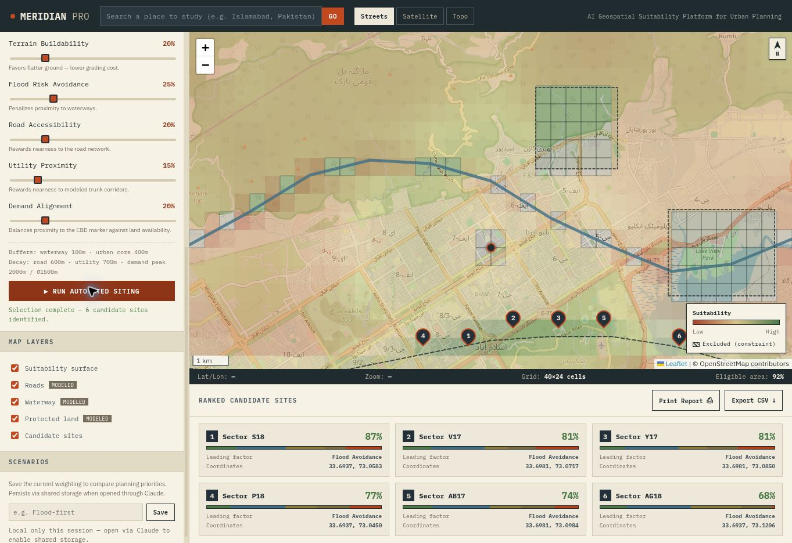
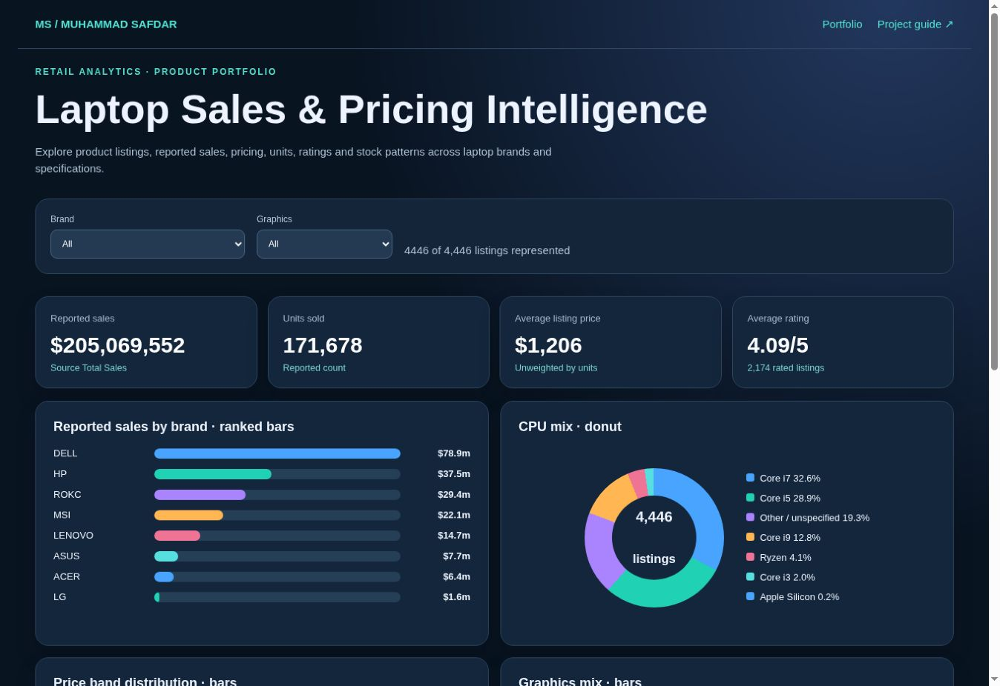
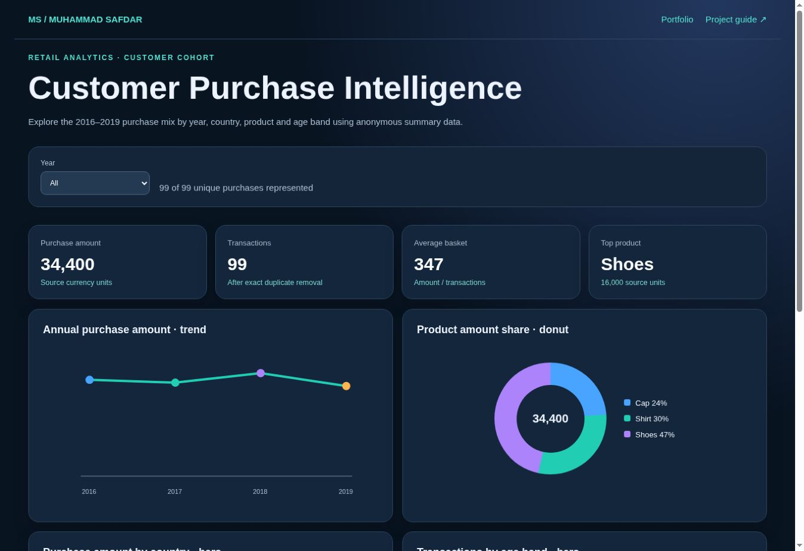
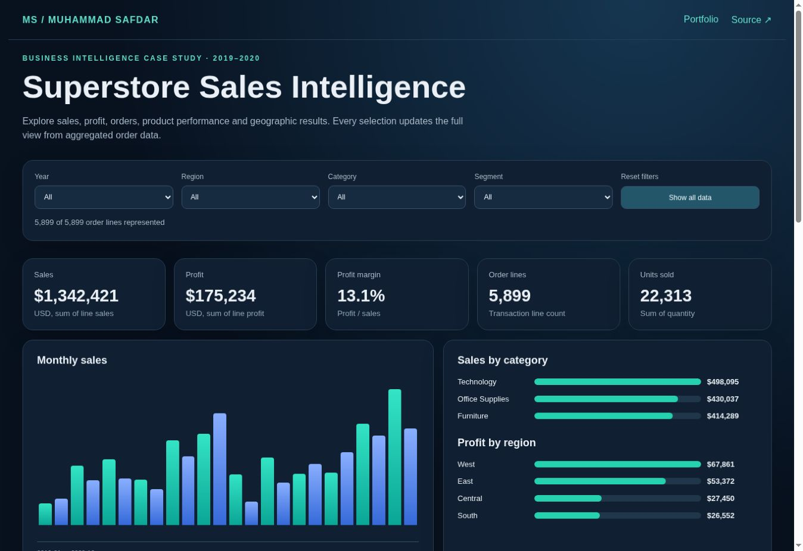

### Generative AI & Agentic Applications · GeoAI · Data Science · Enterprise GIS

I build Python applications that connect **language models, useful tools, spatial data and evidence** to support real decisions.

**Pakistan & GCC project experience · Open to global opportunities**

<a href="#generative-ai">🤖 Generative AI</a> · <a href="#geoai">🛰️ GeoAI & GIS</a> · <a href="#ml">🧠 Machine Learning</a> · <a href="#bi">📊 Business Intelligence</a> · <a href="#engineering">🏗️ Engineering</a> · <a href="#learning">🌱 Learning</a>

## 🤖 01 · Generative AI & Agentic Applications

**From conversation to reviewed action.** Projects are ordered by function: voice → career and research → knowledge support → health and finance → engineering.

<table>
<tr><th>Project</th><th>Role & implemented workflow</th><th>Explore</th></tr>
<tr><td width="24%"><strong>01 · 🎙️ TravelTalk AI</strong></td><td width="56%"><strong>Realtime travel voice advisor</strong> Browser WebRTC, interruption support, captions, traveler preferences and transcript export. Generated advice; no live bookings or price verification.</td><td width="20%"><a href="https://github.com/safdar404/traveladvisor-realtime">💻 Source & setup</a></td></tr>
<tr><td width="24%"><strong>02 · 🔊 Voice Agent AI</strong></td><td width="56%"><strong>Conversational voice studio</strong> Record/upload → edit transcript → contextual AI reply → speech and MP3 export.</td><td width="20%"><a href="https://voiceagent-ai.streamlit.app/">🚀 Open app</a> <a href="https://github.com/safdar404/voiceagent-ai">💻 Source & setup</a></td></tr>
<tr><td width="24%"><strong>03 · 🌈 CareerRainbow AI</strong></td><td width="56%"><strong>Resume & career copilot</strong> Structured profile tools, template selection, fact review and PDF/Word exports.</td><td width="20%"><a href="https://resumecvai.streamlit.app/">🚀 Open app</a> <a href="https://github.com/safdar404/resumeai">💻 Source & setup</a></td></tr>
<tr><td width="24%"><strong>04 · 🧠 MarketMind AI</strong></td><td width="56%"><strong>Business research agent</strong> Plan, research, compare and synthesize with evidence review and human approval.</td><td width="20%"><a href="https://markeetmind.streamlit.app/">🚀 Open app</a> <a href="https://github.com/safdar404/marketmind">💻 Source & setup</a></td></tr>
<tr><td width="24%"><strong>05 · 💬 Suleman AI</strong></td><td width="56%"><strong>Multimodal creative assistant</strong> Persona chat, media tools, language tasks and data exploration; provider-dependent features.</td><td width="20%"><a href="https://suleman-ai.streamlit.app/">🚀 Open app</a> <a href="https://github.com/safdar404/sulemanai">💻 Source & setup</a></td></tr>
<tr><td width="24%"><strong>06 · 📚 RAG Studio</strong></td><td width="56%"><strong>Document research & retrieval</strong> Document ingestion, hybrid retrieval, source citations, notebooks and diagnostics.</td><td width="20%"><a href="https://ragstudios.streamlit.app/">🚀 Open app</a> <a href="https://github.com/safdar404/ragstudio">💻 Source & setup</a></td></tr>
<tr><td width="24%"><strong>07 · 🤖 SupportPearlz</strong></td><td width="56%"><strong>Customer support knowledge assistant</strong> Multi-turn retrieval, cited evidence, knowledge viewer and offline demo.</td><td width="20%"><a href="https://supportpearlzai.streamlit.app/">🚀 Open app</a> <a href="https://github.com/safdar404/supportpearlz">💻 Source & setup</a></td></tr>
<tr><td width="24%"><strong>08 · 🏥 HealthAssist v2</strong></td><td width="56%"><strong>Tool-calling health workspace</strong> Seven bounded tools, opt-in encounter context, intake, vitals, care tasks and report drafts. Educational; no clinical validation.</td><td width="20%"><a href="https://github.com/safdar404/healthai">💻 Source & setup</a></td></tr>
<tr><td width="24%"><strong>09 · 🩺 MediGuide AI</strong></td><td width="56%"><strong>Structured symptom guidance</strong> Rule-based warning checks, structured inputs and optional AI guidance/report export. Educational prototype.</td><td width="20%"><a href="https://medical-ai-assistants.streamlit.app/">🚀 Open app</a> <a href="https://github.com/safdar404/medical-ai-assistant">💻 Source & setup</a></td></tr>
<tr><td width="24%"><strong>10 · 💰 FinWise AI</strong></td><td width="56%"><strong>Budgeting & financial scenarios</strong> Income/expense analysis, savings goals, what-if charts and exports; core calculations are rule based.</td><td width="20%"><a href="https://finwis-ai.streamlit.app/">🚀 Open app</a> <a href="https://github.com/safdar404/finwisai">💻 Source & setup</a></td></tr>
<tr><td width="24%"><strong>11 · 🏗️ GharBuilder AI</strong></td><td width="56%"><strong>House design & estimation agent</strong> Reviewed planning tools, concept CAD/3D, IFC, schedule, BOQ and progress workflows. Concepts require professional review.</td><td width="20%"><a href="https://github.com/safdar404/house-build-cad">💻 Source & setup</a></td></tr>
</table>

These projects combine different levels of automation: tool-calling agents, retrieval assistants and rule-based analytics. API features require configured provider access. TravelTalk, HealthAssist v2 and GharBuilder link to source/setup because a public deployment URL has not been confirmed.

<strong>📸 View the application interfaces</strong>

Build a tailored resume through a tool-enabled copilot, structured forms or document import, then choose a design and export.

- Tool-enabled copilot can review and update supported profile facts, list/select templates and invoke the resume generation workflow.
- 15 template designs, seven font families, paper/length settings, date styles and accent controls.
- Fact validation, correction review, readiness checks, preview/edit, PDF and Word exports, plus profile JSON.
- Back buttons and direct experience, education and project shortcuts keep the workflow navigable.

[🚀 Open resume studio](https://resumecvai.streamlit.app/) · [💻 Source code](https://github.com/safdar404/resumeai)

<table>
<tr>
<td width="50%" valign="top"><h3>💬 Suleman AI</h3>
Chat, create images and videos, use language tools and explore data in one rainbow AI studio.
<ul><li>Streaming chat with personas, vision and saved conversations.</li><li>Media studio for image/video creation, plus summarization, translation and quizzes.</li><li>Data studio for charts and AI-assisted insights.</li></ul>
<a href="https://suleman-ai.streamlit.app/">🚀 Open app ↗</a> · <a href="https://github.com/safdar404/sulemanai">💻 Source ↗</a> · <a href="https://safdar404.github.io/assets/streamlit-suite/sulemanai-actual-20261028.jpg">📸 Full interface ↗</a>
</td>
<td width="50%" valign="top"><h3>💰 FinWise AI</h3>
Analyse budgets, explore spending charts, simulate expense cuts and track savings goals.
<ul><li>Editable income, ten expense categories, savings goals and quick-start presets.</li><li>Interactive spending charts, transparent rule score and 50/30/20 comparisons.</li><li>What-if controls, growth assumptions, offline chat and PDF/JSON/CSV export.</li></ul>
<a href="https://finwis-ai.streamlit.app/">🚀 Open app ↗</a> · <a href="https://github.com/safdar404/finwisai">💻 Source ↗</a> · <a href="https://safdar404.github.io/assets/streamlit-suite/finwisai-actual-20261028.jpg">📸 Full interface ↗</a>
</td>
</tr>
<tr>
<td width="50%" valign="top"><h3>📚 RAG Studio</h3>
Explore document Q&amp;A with hybrid retrieval, source citations, notebooks and retrieval diagnostics.
<ul><li>PDFs and scans, Word, images, CSV, TXT and Markdown ingestion.</li><li>Semantic + BM25 hybrid search, query rewriting, optional re-ranking and citation checks.</li><li>Agent personas, multilingual answers, pinned notes, offline library insights and exports.</li></ul>
<a href="https://ragstudios.streamlit.app/">🚀 Open app ↗</a> · <a href="https://github.com/safdar404/ragstudio">💻 Source ↗</a> · <a href="https://safdar404.github.io/assets/streamlit-suite/ragstudio-actual-20261028.jpg">📸 Full interface ↗</a>
</td>
<td width="50%" valign="top"><h3>🩺 MediGuide AI</h3>
Review structured symptom guidance with rule checks, language options and downloadable reports.
<ul><li>Structured age, symptoms, duration, severity, vital signs and background inputs.</li><li>Deterministic red-flag checks run before AI guidance; optional language and voice controls.</li><li>Guidance organizes warning signs, next steps and questions for a healthcare professional, with PDF export.</li></ul>
<a href="https://medical-ai-assistants.streamlit.app/">🚀 Open app ↗</a> · <a href="https://github.com/safdar404/medical-ai-assistant">💻 Source ↗</a> · <a href="https://safdar404.github.io/assets/streamlit-suite/medical-ai-assistant-actual-20261028.jpg">📸 Full interface ↗</a>
</td>
</tr>
<tr>
<td width="50%" valign="top"><h3>🧠 MarketMind AI</h3>
Follow a bounded business-research agent from brief and evidence to quality review and approval.
<ul><li>Plan → research → compare → synthesize → quality review → named human approval.</li><li>Schema-validated tools, evidence-linked claims and bounded iterations, tool calls and cost.</li><li>Inspect evidence, quality verdicts, reports, usage, corpus and recorded runs.</li></ul>
<a href="https://markeetmind.streamlit.app/">🚀 Open app ↗</a> · <a href="https://github.com/safdar404/marketmind">💻 Source ↗</a> · <a href="https://safdar404.github.io/assets/streamlit-suite/marketmind-actual-20261028.jpg">📸 Full interface ↗</a>
</td>
<td width="50%" valign="top"><h3>🤖 SupportPearlz</h3>
Ask support questions with cited document retrieval, an offline demo and inspectable evidence.
<ul><li>Multi-turn FAISS retrieval, follow-up rewriting and validated source citations.</li><li>Offline extractive demo over 12 fictional company documents; no API key required for the demo.</li><li>Knowledge viewer, document search, retrieval lab, feedback, session stats and Markdown export.</li></ul>
<a href="https://supportpearlzai.streamlit.app/">🚀 Open app ↗</a> · <a href="https://github.com/safdar404/supportpearlz">💻 Source ↗</a> · <a href="https://safdar404.github.io/assets/streamlit-suite/supportpearlz-actual-20261028.jpg">📸 Full interface ↗</a>
</td>
</tr>
</table>

Actual interfaces captured 28 October 2026. FinWise uses a built-in illustrative budget; SupportPearlz shows its offline extractive demo. Suleman AI and RAG Studio show their real connection screens. Optional AI features require a configured API and may incur provider charges. MediGuide and FinWise are educational prototypes; MarketMind and SupportPearlz include fictional demonstration documents.

<strong>🎙️ Explore the newest voice projects</strong>

**TravelTalk AI:** realtime browser voice conversations with typed prompts, mute/interrupt controls and multilingual travel preferences. [Source & run instructions](https://github.com/safdar404/traveladvisor-realtime)

Avatar and workflow artwork are branding, not interface screenshots. A live microphone/API call is not implied by the profile review.

### Document intelligence & specialist research

| Project | Role & function | Explore |
|---|---|---|
| **Lexora Legal Research** | Browser passage search and cited excerpts from local text; full Python OCR/LLM package is a separate implementation. | [Browser demo](https://safdar404.github.io/lexora-legal-rag/) |
| **LangChain RAG Assistant** | OpenAI embeddings, SingleStore vector retrieval and source snippets. | [Source](https://github.com/safdar404/LangChain-RAG-Application) |
| **HIS AI Agentic Solutions** | Specialist-agent showcase with tools, validation and human review. | [Showcase](https://his-ai-agentic-solutions.lovable.app/) |
| **AI HealthAssist · earlier interface** | Educational intake, vitals and health GIS prototype; distinct from HealthAssist v2 above. | [Interface](https://ai-healthassist.ai.studio/) · [Source](https://github.com/safdar404/HIS-AI-HealthAssist) |

## 🛰️ 02 · GeoAI, GIS & Spatial Decision Support

<table>
<tr>
<td width="34%" valign="middle"><strong>GeoSentinel Drain FloodOps</strong>  Drainage · Flood operations · GIS</td>
<td width="66%" valign="top"><strong>GeoSentinel Drain FloodOps</strong>  
A GeoSentinel project focused on drainage and flood operations.  
<a href="https://geosentinel-drain-floodops.neat-grove-8624.chatgpt.site/"><strong>Open application</strong></a> ChatGPT sign-in is required to access the application.
</td>
</tr>

<tr>
<td width="34%" valign="middle">
 Original interface / analysis
</td>
<td width="66%" valign="top">
<strong>Islamabad Feature Intelligence</strong> 
Sentinel-2 false-colour, NDVI and land-cover map  
245,909 footprint references with an expanded map, controls outside the canvas and docked feature details. Optional 3D heights by building type: 3 / 6 / 9 m assumed scenarios, not measured heights. The image previews Sentinel-2 analysis.  
ArcGIS · Python · GeoAI 
<a href="https://islamabad-feature-intelligence.safdarwatto7714.chatgpt.site"><strong>Open live dashboard</strong></a>
</td>
</tr>
<tr>
<td width="34%" valign="middle">
 Original interface / analysis
</td>
<td width="66%" valign="top">
<strong>GeoAI Resilience Intelligence Suite</strong> 
Urban growth · Flood response · Utilities · Drainage · EO change  
Five spatial planning workflows with a linked Python research toolkit.  
Python · GeoAI · GIS 
<a href="https://geoai-resilience-intelligence-suite.neat-grove-8624.chatgpt.site/"><strong>View project</strong></a> · <a href="https://github.com/safdar404/geoai-resilience-research-lab"><strong>Source</strong></a>
</td>
</tr>
<tr>
<td width="34%" valign="middle">
 Project logo
</td>
<td width="66%" valign="top">
<strong>AgriSentinel Pakistan</strong> 
Crop health · Satellites · QA · RAG · ML  
Monitor crop fields, review satellite indices, track pesticide follow-up and explore source-cited guidance and harvest models.  
GeoAI · Sentinel-2 · Agriculture · ML 
<a href="https://safdar404.github.io/geosentinel-floodops/"><strong>View project</strong></a> · <a href="https://github.com/safdar404/safdar404.github.io/tree/main/geosentinel-floodops"><strong>Source</strong></a>
</td>
</tr>
<tr>
<td width="34%" valign="middle">
<strong>Documented implementation</strong>  <code>public/pakistan-boundary.geojson</code> React / TypeScript District markers + scenario views
</td>
<td width="66%" valign="top">
<strong>Pakistan National Flood Intelligence</strong> 
35 priority districts · 5 scenarios · 4 response phases  
Repository-documented national screening. River observations are dated 5 August 2026; scenario scores are qualitative.  
React · TypeScript · GeoJSON 
<a href="https://pakistan-flood-intelligence-2026.neat-grove-8624.chatgpt.site/"><strong>View project</strong></a> · <a href="https://github.com/safdar404/Pakistan-National-Flood-Intelligence"><strong>Source</strong></a>
</td>
</tr>
<tr>
<td width="34%" valign="middle">
 Original interface / analysis
</td>
<td width="66%" valign="top">
<strong>GeoSentinel AI</strong> 
Nullah Lai · Margalla catchment · Incident workflows  
Flood dashboard, incident intelligence, evidence review and work-order verification.  
Web GIS · Flood intelligence · Incident workflows 
<a href="https://geosentinel-ai-1.ai.studio/"><strong>Open live app</strong></a>
</td>
</tr>
<tr>
<td width="34%" valign="middle">
 Actual interface · modeled scenario
</td>
<td width="66%" valign="top">
<strong>GeoAI Site Intelligence Suite</strong> 
MERIDIAN · GEOSENTINEL · SOLARIS  
Actual MERIDIAN siting interface: 960-cell demonstration using modeled overlays; not surveyed site recommendations.  
Python · GeoAI · GIS 
<a href="https://safdar404.github.io/geoai-site-intelligence/"><strong>View suite</strong></a> · <a href="https://github.com/safdar404/safdar404.github.io/tree/main/geoai-site-intelligence"><strong>Source</strong></a>
</td>
</tr>
<tr>
<td width="34%" valign="middle">
 Original interface / analysis
</td>
<td width="66%" valign="top">
<strong>Pakistan Infrastructure GIS Command Centre</strong> 
Utilities · Field verification · Progress · Data QA  
Punjab infrastructure prototype; map overlays and operational metrics are illustrative.  
Infrastructure GIS · Utilities · Project monitoring 
<a href="https://pmu-pdp-infrastructure-gis.neat-grove-8624.chatgpt.site/"><strong>View project</strong></a>
</td>
</tr>
</table>

### Land-cover research & dataset preparation

| Project | Role & function | Explore |
|---|---|---|
| **GeoDistill Studio** | Browser image pixel/resolution inspection and class distribution; full Python model training requires a backend. | [Open workbench](https://safdar404.github.io/geodistill-studio/) |
| **Land Cover Dataset Preparation** | Manifest QA, split leakage, file duplication and cleaned CSV export. | [Open dataset QA](https://safdar404.github.io/land-cover-data-preparation/) |
| **Interactive RAG & GeoAI Labs** | Lexical evidence search, land-cover class exploration and CSV audit demos. | [Open labs](https://safdar404.github.io/rag-geoai-labs/) |

Spatial prototypes need authoritative data and field validation. Simulated heights, modeled suitability overlays and scenario scores are labeled assumptions.

## 🧠 03 · Machine Learning & Data Science

<table>

<tr>
<td width="34%" valign="middle">
 Original interface / analysis
</td>
<td width="66%" valign="top">
<strong>Python &amp; AI Analytics Lab</strong> 
Heart ML · Hospital analysis · Stock RNN · FDA device RNN  
Four educational workspaces with analysis, evaluation charts and Python source.  
Pandas · scikit-learn · TensorFlow/Keras 
<a href="https://safdar404.github.io/python-ai-lab/"><strong>View project</strong></a> · <a href="https://github.com/safdar404/Fullstack-AI-BOOTCAMP-B-10"><strong>Source</strong></a>
</td>
</tr>
<tr>
<td width="34%" valign="middle">
 Original interface / analysis
</td>
<td width="66%" valign="top">
<strong>Prediction Studio</strong> 
CSV upload · Model audit · Capacity · Inventory · Trends  
Client-side calculations with labeled samples, row validation and analyzed-record exports.  
CSV analytics · Model evaluation · Client-side JavaScript 
<a href="https://safdar404.github.io/prediction-studio/"><strong>View project</strong></a> · <a href="https://github.com/safdar404/Fullstack-AI-BOOTCAMP-B-10"><strong>Source</strong></a>
</td>
</tr>

</table>

<strong>📈 Eight applied ML studies · charts, metrics & evaluation notes</strong>

## Applied AI/ML — eight collective dashboards

Classification, regression, customer segmentation and time-series forecasting with original charts from my completed project notebooks.

[**Explore all eight dashboards at full size**](https://safdar404.github.io/applied-ml-analysis/)

### Sonar Signal Classification

**Accuracy 81.0% · ROC AUC 0.939 · Average precision 0.950**

Supplied tuned SVC dashboard; 42 test samples. This run differs from the earlier baseline evaluation.

[View analysis](https://safdar404.github.io/applied-ml-analysis/#sonar) · [Open original image](https://safdar404.github.io/assets/ml-dashboards/sonar.png)

### Breast Cancer Classification

**Accuracy 96.5% · Malignant recall 92.9% · ROC AUC 0.990**

Educational dataset evaluation; 3 missed malignant cases and 1 false positive in the displayed test set.

[View analysis](https://safdar404.github.io/applied-ml-analysis/#cancer) · [Open original image](https://safdar404.github.io/assets/ml-dashboards/cancer.png)

### Credit Card Fraud Detection

**Fraud recall 83.7% · Precision 88.2% · Average precision 0.861**

Supplied notebook run at threshold 0.25: 82 detected frauds, 16 missed frauds and 11 false alarms. This differs from the earlier duplicate-removed experiment.

[View analysis](https://safdar404.github.io/applied-ml-analysis/#fraud) · [Open original image](https://safdar404.github.io/assets/ml-dashboards/fraud.png)

### House Price Prediction

**MAE $30,846 · RMSE $46,504 · R² 0.835**

California housing evaluation with geographic and price-range error analysis.

[View analysis](https://safdar404.github.io/applied-ml-analysis/#house-price) · [Open original image](https://safdar404.github.io/assets/ml-dashboards/house-price.png)

### Medical Insurance Cost Prediction

**MAE 1,959.91 · RMSE 4,284.29 · R² 0.900**

Log-target random-forest evaluation with subgroup errors and feature importance; educational estimates.

[View analysis](https://safdar404.github.io/applied-ml-analysis/#insurance-cost) · [Open original image](https://safdar404.github.io/assets/ml-dashboards/insurance-cost.png)

### Customer Segmentation

**200 customers · 5 clusters · Silhouette 0.555**

Customer profiles, cluster sizes, elbow and silhouette analysis; cluster IDs are arbitrary.

[View analysis](https://safdar404.github.io/applied-ml-analysis/#customer-segmentation) · [Open original image](https://safdar404.github.io/assets/ml-dashboards/customer-segmentation.png)

### Fake News Text Classification

**Accuracy 95.4% · Macro F1 0.954 · ROC AUC 0.991**

TF-IDF and LinearSVC evaluation, term weights and text-length errors. Numeric class labels are retained; this model does not verify factual truth.

[View analysis](https://safdar404.github.io/applied-ml-analysis/#fake-news) · [Open original image](https://safdar404.github.io/assets/ml-dashboards/fake-news.png)

### Airline Passenger Forecasting

**Log-SARIMAX RMSE 18.83 · Seasonal-naive RMSE 50.71 · ARIMA RMSE 86.81**

Historical passenger series, chronological validation, residuals and 1961 forecasts.

[View analysis](https://safdar404.github.io/applied-ml-analysis/#airline-forecast) · [Open original image](https://safdar404.github.io/assets/ml-dashboards/airline-forecast.png)

**Shared frontend:** prepared Streamlit tools support sample inputs, batch predictions and evaluation views. Online Streamlit deployment is pending.

> Displayed figures come from the supplied dashboard screenshots. Educational evaluations are not clinical validation or evidence of operational fraud-detection reliability. Earlier comparison assets remain in the repository.

---

## 📊 04 · Business Intelligence & Operational Analytics

**Power BI · DAX · Power Query · Data QA** — dashboards grouped around retail, customer behavior and sales performance.

<table>
<tr>
<td width="34%" valign="middle">
 Actual dashboard · all filters
</td>
<td width="66%" valign="top">
<strong>Laptop Sales &amp; Pricing Intelligence</strong> 
4,446 listings · 171,678 reported units · $205.07m reported sales  
Actual dashboard, all filters selected. Source sales inconsistencies are documented; this is not a date-based sales trend.  
Power BI · DAX · Retail Analytics 
<a href="https://safdar404.github.io/laptop-intelligence/"><strong>Open dashboard</strong></a> · <a href="https://github.com/safdar404/safdar404.github.io/tree/main/laptop-intelligence"><strong>Model guide</strong></a>
</td>
</tr>
<tr>
<td width="34%" valign="middle">
 Actual dashboard · all filters
</td>
<td width="66%" valign="top">
<strong>Customer Purchase Intelligence</strong> 
99 unique purchases · 34,400 source units · 2016–2019  
Actual dashboard after exact duplicate removal. Source currency is unspecified.  
Power BI · DAX · Customer Analytics 
<a href="https://safdar404.github.io/customer-purchase-intelligence/"><strong>Open dashboard</strong></a> · <a href="https://github.com/safdar404/safdar404.github.io/tree/main/customer-purchase-intelligence"><strong>Model guide</strong></a>
</td>
</tr>
<tr>
<td width="34%" valign="middle">
 Actual dashboard · all filters
</td>
<td width="66%" valign="top">
<strong>Superstore Sales Intelligence</strong> 
5,899 lines · $1.342m sales · $175,234 profit · 13.1% margin  
Actual dashboard, all filters selected. The unmatched Returns sheet is excluded from return-rate calculations.  
Power BI · DAX · Data Analytics 
<a href="https://safdar404.github.io/superstore-bi/"><strong>Open dashboard</strong></a> · <a href="https://github.com/safdar404/safdar404.github.io/tree/main/superstore-bi"><strong>Power BI guide</strong></a>
</td>
</tr>
</table>

## 🏗️ 05 · Engineering, BIM & Document Automation

**GharBuilder AI** connects reviewed concept design, CAD/3D, IFC, scheduling and cost workflows. [Explore source & setup](https://github.com/safdar404/house-build-cad)

<table>
<tr>
<td width="34%" valign="middle">
<strong>Documented OCR fields</strong>  Vendor · Invoice number/date PKR / SAR / AED / USD Subtotal · Tax · Total Line items → CSV
</td>
<td width="66%" valign="top">
<strong>Zarwa Bill Scanner / HIS Bill Scanner</strong> 
Camera / upload · OCR review · Structured CSV  
Repository documents browser-based Tesseract.js and PDF.js; vendor, invoice, currency, tax, totals and line items.  
Tesseract.js · React · TypeScript 
<a href="https://his-bill-scanner.neat-grove-8624.chatgpt.site/"><strong>View project</strong></a> · <a href="https://github.com/safdar404/HIS-Bill-Scanner"><strong>Source</strong></a>
</td>
</tr>
<tr>
<td width="34%" valign="middle">
 Original interface / analysis
</td>
<td width="66%" valign="top">
<strong>Planora AI — CAD, BIM &amp; GIS Flow</strong> 
Project brief · CAD/BIM · MEP · GIS · Costing  
Original application screenshot. Source is private; engineering outputs require professional review.  
CAD · BIM–GIS · 3D 
<a href="https://ai-cad-bim-flow.lovable.app/"><strong>View project</strong></a> · <a href="https://github.com/safdar404/AI-Cad-Bim-Flow"><strong>Source (private)</strong></a>
</td>
</tr>
<tr>
<td width="34%" valign="middle">
<strong>Verified extraction schema</strong>  <code>ScanRecord</code> component · tag · duct_size_mm airflow · airflow_unit confidence_pct · source_line
</td>
<td width="66%" valign="top">
<strong>MEP Scanner System</strong> 
Drawing pages · Component tags · Duct sizes · Airflow  
Verified app.py extracts MEP components, dimensions and airflow, retaining OCR confidence and source lines.  
Python · EasyOCR · OpenCV 
<a href="https://mep-scanner-system.neat-grove-8624.chatgpt.site/"><strong>View project</strong></a> · <a href="https://github.com/safdar404/HIS-MEP-Scanner-System."><strong>Source</strong></a>
</td>
</tr>
</table>

Related earlier OCR implementations: MEP Drawing Analyzer, Alfanar MEP OCR and Zarwa/HIS Bill Scanner. See the <a href="./projects/profile-project-history.md">project history and implementation notes</a>.

## 🌱 06 · Learning & Personal Growth

### Steady · Growth Companion

**A little stronger, every day.** A personal growth companion that brings daily planning, learning, reflection and everyday wellbeing into one calm workspace.

- **Plan:** organize daily activities and small next steps.
- **Learn:** explore lessons, guided practice and learning/recall tools.
- **Reflect:** use a thought journal, wellbeing resources and progress pages.
- **Local by default:** browser-based entries with English and partial Urdu support.

[**Open Steady ↗**](https://safdar-mindful-growth.safdarwatto7714.chatgpt.site/) · [**Project documentation**](https://github.com/safdar404/safdar404.github.io/tree/main/projects/steady) · [**Portfolio**](https://safdar404.github.io/)

Branded overview graphic, not an app screenshot. Educational wellbeing support; not diagnosis or a replacement for professional care. This repository entry documents the hosted app; application source is not included.

| Repository | Focus |
|---|---|
| [FULLSTACK-AI-B-9](https://github.com/safdar404/FULLSTACK-AI-B-9) | Python, AI/ML coursework and practical experiments |
| [Fullstack-AI-BOOTCAMP-B-10](https://github.com/safdar404/Fullstack-AI-BOOTCAMP-B-10) | Python, AI/ML coursework and practical experiments |
| [huwaeiai](https://github.com/safdar404/huwaeiai) | Python, AI/ML coursework and practical experiments |

<strong>🛠️ Tools, libraries & platforms</strong>

<!-- TOOL-LOGOS-START -->
## 🛠️ Tools & Technology

### AI/ML & Data Science

  
  
  
  
  
  
  

Python · NumPy · Pandas · scikit-learn · TensorFlow · Keras · OpenCV

### Data, APIs & Applications

  
  
  
  
  

PostgreSQL / PostGIS · SQLite · FastAPI · Streamlit · Docker

### Power BI & Business Intelligence

**Microsoft Power BI** · DAX · Power Query · Dashboard design

### GIS & Remote Sensing

**ArcGIS Pro / Enterprise · QGIS** · Google Earth Engine · FME · Agisoft Metashape

### CAD & Engineering

**AutoCAD · Civil 3D** · BIM/IFC · CAD-to-GIS workflows

### Workflow Automation

  
  

**n8n · Make.com** · Visual workflows · API integrations · Automation

<strong>Complete technical stack</strong>

**AI & Data Science:** Python, Pandas, NumPy, scikit-learn, TensorFlow/Keras, OpenCV, Hugging Face, LangChain, RAG  
**Workflow Automation:** n8n, Make.com, visual workflows and API integrations  
**Data & APIs:** SQL, PostgreSQL/PostGIS, SQLite, ETL, FastAPI, Flask, REST, Streamlit, Docker  
**GIS & Remote Sensing:** ArcGIS Pro/Enterprise, QGIS, Google Earth Engine, FME, Agisoft Metashape  
**Geospatial Python:** ArcPy, GeoPandas, GDAL, Rasterio, Shapely, Fiona, PyProj, Folium, Leaflet  
**Engineering & Cloud:** AutoCAD, Civil 3D, BIM/IFC, CAD-to-GIS, Power BI, AWS, Azure, Google Cloud

<!-- TOOL-LOGOS-END -->

<strong>💼 Professional delivery & education</strong>

## Professional delivery

| Period | Role & organization | Selected contribution |
|---|---|---|
| **2025—Present** | **GIS & GeoAI Specialist · Professional Geo Tech Services FZC LLC** | NWC Riyadh wastewater mapping, infrastructure/GNSS delivery and environmental spatial analysis |
| **2023—2025** | **GIS Expert · TerraSense Consulting** | GeoAI land-cover workflows, satellite crop intelligence, wheat estimation and predictive analysis |
| **2021—2023** | **GIS Specialist · FGEHA, Islamabad** | Enterprise geodatabases, CAD-to-GIS, topology QA and training of 20+ personnel |
| **2019—2021** | **GIS Manager · Kernel Seeds Corporation** | Agricultural GIS, crop analysis, spatial repositories and data governance |
| **2017—2019** | **GIS Manager · PDMA Punjab** | Chenab/Sutlej flood intelligence, exposure analysis and emergency situation mapping |
| **2012—2017** | **GIS Professional · The Urban Unit & Loyal Consultants** | Urban, land, infrastructure, survey GIS, spatial databases and cartographic production |

## Education & credentials

- **MSc Geographic Information Systems** — University of the Punjab, Lahore
- **BSc Computer Science, Economics & Statistics** — The Islamia University of Bahawalpur
- **Python with Full Stack AI** — NexSkills, 2026
- **Artificial Intelligence Using Python** and **Data Analytics & Business Intelligence** — DigiSkills, 2026
- **AWS Cloud Practitioner Essentials** · **Cisco Python Essentials 1**
- **GACA Remote Pilot Certificate** · **Esri Spatial Data Science, Imagery and Cartography training**

---

### Let’s build useful intelligence.

**Generative AI · Python · GeoAI · GIS · Data Engineering · Business Intelligence**

[Portfolio](https://safdar404.github.io/) · [LinkedIn](https://www.linkedin.com/in/muhammad-safdar-88b27730) · [Email](mailto:safdar404@gmail.com) · [WhatsApp](https://wa.me/923228792404) · [Resume](https://smhisresume.com/)

