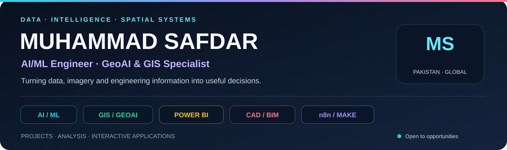
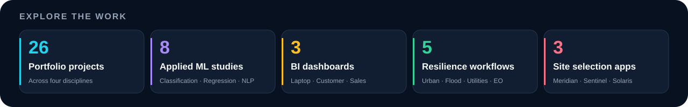
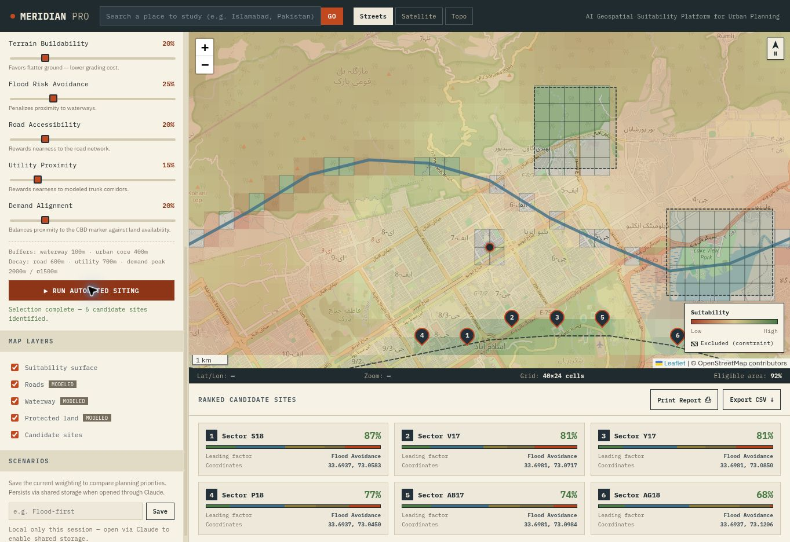
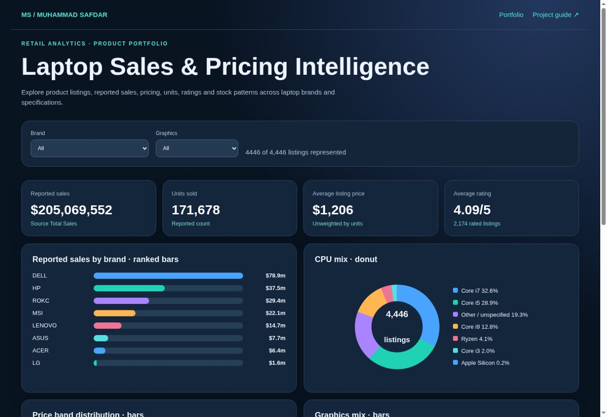
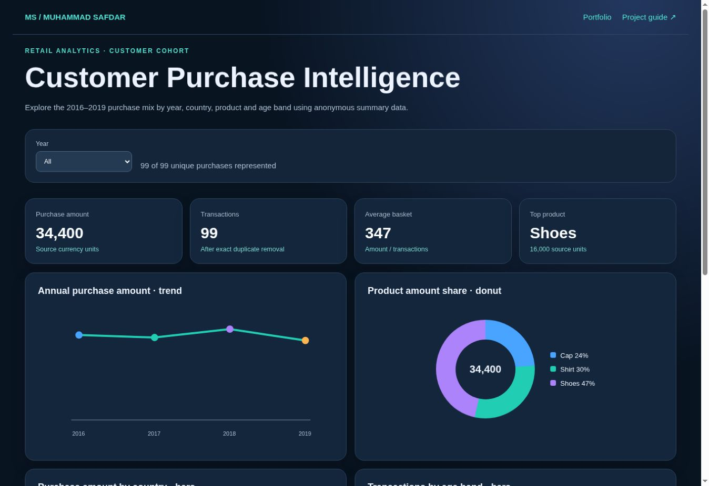
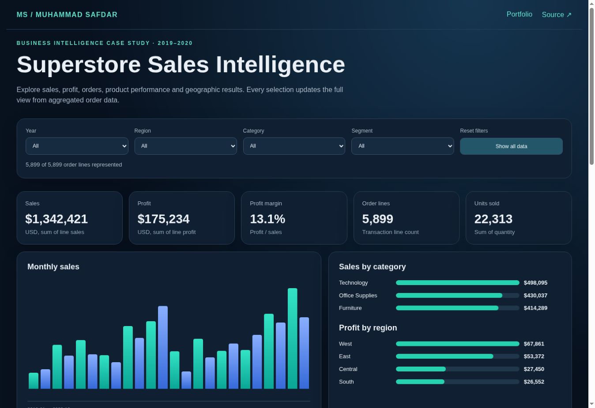

### Data Scientist · AI/ML Engineer · GeoAI & Enterprise GIS Specialist

I transform spatial, engineering and business data into validated analysis, production-minded applications and decision-ready intelligence.

**15+ years professional delivery · Pakistan & GCC experience · Open to global opportunities**

---

<!-- VOICEAGENT-FEATURE-START -->
## 🎙️ Featured launch · Voice Agent AI

**Speak your question. Review your words. Hear AI respond.** A Python voice application combining speech recognition, contextual conversation and AI-generated speech in one Streamlit workspace.

🎤 **Record or upload** audio · ✍️ **Review editable transcripts** · 💬 **Type or speak** your questions · 🔊 **Choose a voice** and download MP3 replies.

🌍 English, Urdu, Portuguese and Arabic reply options · 🧠 Travel advisor, GeoAI/GIS tutor, interview coach and general assistant · 📥 Conversation export · 🔑 Your own OpenAI API key.

[**🚀 Try Voice Agent AI**](https://voiceagent-ai.streamlit.app/) · [**💻 Explore the source**](https://github.com/safdar404/voiceagent-ai) · [**🌐 Browse my portfolio**](https://safdar404.github.io/)

Branded project overview, not an app screenshot. Turn-based record-and-send conversation; API access and usage charges apply.
<!-- VOICEAGENT-FEATURE-END -->

## What I deliver

| Capability | Applied work |
|---|---|
| **Data Science & AI** | Classification, regression, forecasting, computer vision, RAG, evaluation and explainable outputs |
| **Data Engineering & APIs** | ETL, SQL, validation, REST APIs, structured/vector data and deployment workflows |
| **GeoAI & Spatial Systems** | Enterprise GIS, remote sensing, urban planning, utilities, disaster intelligence and spatial decision support |
| **Engineering Intelligence** | CAD/BIM-to-GIS, MEP document analysis, GNSS/UAV and infrastructure information workflows |

> **Current focus:** trustworthy GeoAI, agent-ready spatial services, applied AI, data engineering and decision-support products.

---

## 📊 Power BI & Decision Intelligence

I use **Power BI, DAX and Power Query** to turn operational, business and geospatial data into governed metrics, interactive dashboards and decision-ready reporting.

[Explore the three implemented BI dashboards and their source notes below.](#-business-intelligence)

**Power BI · DAX · Power Query · SQL/PostGIS · Python · GIS · Remote Sensing · Spatial Analytics**

---

<!-- TOOL-LOGOS-START -->
## 🛠️ Tools & Technology

### AI/ML & Data Science

  
  
  
  
  
  
  

Python · NumPy · Pandas · scikit-learn · TensorFlow · Keras · OpenCV

### Data, APIs & Applications

  
  
  
  
  

PostgreSQL / PostGIS · SQLite · FastAPI · Streamlit · Docker

### Power BI & Business Intelligence

**Microsoft Power BI** · DAX · Power Query · Dashboard design

### GIS & Remote Sensing

**ArcGIS Pro / Enterprise · QGIS** · Google Earth Engine · FME · Agisoft Metashape

### CAD & Engineering

**AutoCAD · Civil 3D** · BIM/IFC · CAD-to-GIS workflows

### Workflow Automation

  
  

**n8n · Make.com** · Visual workflows · API integrations · Automation

<strong>Complete technical stack</strong>

**AI & Data Science:** Python, Pandas, NumPy, scikit-learn, TensorFlow/Keras, OpenCV, Hugging Face, LangChain, RAG  
**Workflow Automation:** n8n, Make.com, visual workflows and API integrations  
**Data & APIs:** SQL, PostgreSQL/PostGIS, SQLite, ETL, FastAPI, Flask, REST, Streamlit, Docker  
**GIS & Remote Sensing:** ArcGIS Pro/Enterprise, QGIS, Google Earth Engine, FME, Agisoft Metashape  
**Geospatial Python:** ArcPy, GeoPandas, GDAL, Rasterio, Shapely, Fiona, PyProj, Folium, Leaflet  
**Engineering & Cloud:** AutoCAD, Civil 3D, BIM/IFC, CAD-to-GIS, Power BI, AWS, Azure, Google Cloud

<!-- TOOL-LOGOS-END -->

---

<!-- STEADY-GROWTH-START -->
## 🌱 Steady · Growth Companion

**A little stronger, every day.** A personal growth companion that brings daily planning, learning, reflection and everyday wellbeing into one calm workspace.

- **Plan:** organize daily activities and small next steps.
- **Learn:** explore lessons, guided practice and learning/recall tools.
- **Reflect:** use a thought journal, wellbeing resources and progress pages.
- **Local by default:** browser-based entries with English and partial Urdu support.

[**Open Steady ↗**](https://safdar-mindful-growth.safdarwatto7714.chatgpt.site/) · [**Project documentation**](https://github.com/safdar404/safdar404.github.io/tree/main/projects/steady) · [**Portfolio**](https://safdar404.github.io/)

Branded overview graphic, not an app screenshot. Educational wellbeing support; not diagnosis or a replacement for professional care. This repository entry documents the hosted app; application source is not included.
<!-- STEADY-GROWTH-END -->

<!-- PROJECT-GALLERY-START -->
<!-- STREAMLIT-SUITE:START -->
## 🌈 Applied AI · Eight Live Python Applications

Eight distinct apps with rainbow branding, including seven captured interfaces and the featured Voice Agent overview, custom agent identities and working application/source links. Click a screenshot to inspect the full interface, or open the app to use its workflow.

### 🌈 CareerRainbow AI — Agentic Resume Copilot

Build a tailored resume through a tool-enabled copilot, structured forms or document import, then choose a design and export.

- Tool-enabled copilot can review and update supported profile facts, list/select templates and invoke the resume generation workflow.
- 15 template designs, seven font families, paper/length settings, date styles and accent controls.
- Fact validation, correction review, readiness checks, preview/edit, PDF and Word exports, plus profile JSON.
- Back buttons and direct experience, education and project shortcuts keep the workflow navigable.

[🚀 Open resume studio](https://resumecvai.streamlit.app/) · [💻 Source code](https://github.com/safdar404/resumeai)

<table>
<tr>
<td width="50%" valign="top"><h3>💬 Suleman AI</h3>
Chat, create images and videos, use language tools and explore data in one rainbow AI studio.
<ul><li>Streaming chat with personas, vision and saved conversations.</li><li>Media studio for image/video creation, plus summarization, translation and quizzes.</li><li>Data studio for charts and AI-assisted insights.</li></ul>
<a href="https://suleman-ai.streamlit.app/">🚀 Open app ↗</a> · <a href="https://github.com/safdar404/sulemanai">💻 Source ↗</a> · <a href="https://safdar404.github.io/assets/streamlit-suite/sulemanai-actual-20261028.jpg">📸 Full interface ↗</a>
</td>
<td width="50%" valign="top"><h3>💰 FinWise AI</h3>
Analyse budgets, explore spending charts, simulate expense cuts and track savings goals.
<ul><li>Editable income, ten expense categories, savings goals and quick-start presets.</li><li>Interactive spending charts, transparent rule score and 50/30/20 comparisons.</li><li>What-if controls, growth assumptions, offline chat and PDF/JSON/CSV export.</li></ul>
<a href="https://finwis-ai.streamlit.app/">🚀 Open app ↗</a> · <a href="https://github.com/safdar404/finwisai">💻 Source ↗</a> · <a href="https://safdar404.github.io/assets/streamlit-suite/finwisai-actual-20261028.jpg">📸 Full interface ↗</a>
</td>
</tr>
<tr>
<td width="50%" valign="top"><h3>📚 RAG Studio</h3>
Explore document Q&amp;A with hybrid retrieval, source citations, notebooks and retrieval diagnostics.
<ul><li>PDFs and scans, Word, images, CSV, TXT and Markdown ingestion.</li><li>Semantic + BM25 hybrid search, query rewriting, optional re-ranking and citation checks.</li><li>Agent personas, multilingual answers, pinned notes, offline library insights and exports.</li></ul>
<a href="https://ragstudios.streamlit.app/">🚀 Open app ↗</a> · <a href="https://github.com/safdar404/ragstudio">💻 Source ↗</a> · <a href="https://safdar404.github.io/assets/streamlit-suite/ragstudio-actual-20261028.jpg">📸 Full interface ↗</a>
</td>
<td width="50%" valign="top"><h3>🩺 MediGuide AI</h3>
Review structured symptom guidance with rule checks, language options and downloadable reports.
<ul><li>Structured age, symptoms, duration, severity, vital signs and background inputs.</li><li>Deterministic red-flag checks run before AI guidance; optional language and voice controls.</li><li>Guidance organizes warning signs, next steps and questions for a healthcare professional, with PDF export.</li></ul>
<a href="https://medical-ai-assistants.streamlit.app/">🚀 Open app ↗</a> · <a href="https://github.com/safdar404/medical-ai-assistant">💻 Source ↗</a> · <a href="https://safdar404.github.io/assets/streamlit-suite/medical-ai-assistant-actual-20261028.jpg">📸 Full interface ↗</a>
</td>
</tr>
<tr>
<td width="50%" valign="top"><h3>🧠 MarketMind AI</h3>
Follow a bounded business-research agent from brief and evidence to quality review and approval.
<ul><li>Plan → research → compare → synthesize → quality review → named human approval.</li><li>Schema-validated tools, evidence-linked claims and bounded iterations, tool calls and cost.</li><li>Inspect evidence, quality verdicts, reports, usage, corpus and recorded runs.</li></ul>
<a href="https://markeetmind.streamlit.app/">🚀 Open app ↗</a> · <a href="https://github.com/safdar404/marketmind">💻 Source ↗</a> · <a href="https://safdar404.github.io/assets/streamlit-suite/marketmind-actual-20261028.jpg">📸 Full interface ↗</a>
</td>
<td width="50%" valign="top"><h3>🤖 SupportPearlz</h3>
Ask support questions with cited document retrieval, an offline demo and inspectable evidence.
<ul><li>Multi-turn FAISS retrieval, follow-up rewriting and validated source citations.</li><li>Offline extractive demo over 12 fictional company documents; no API key required for the demo.</li><li>Knowledge viewer, document search, retrieval lab, feedback, session stats and Markdown export.</li></ul>
<a href="https://supportpearlzai.streamlit.app/">🚀 Open app ↗</a> · <a href="https://github.com/safdar404/supportpearlz">💻 Source ↗</a> · <a href="https://safdar404.github.io/assets/streamlit-suite/supportpearlz-actual-20261028.jpg">📸 Full interface ↗</a>
</td>
</tr>
</table>

Actual interfaces captured 28 October 2026. FinWise uses a built-in illustrative budget; SupportPearlz shows its offline extractive demo. Suleman AI and RAG Studio show their real connection screens. Optional AI features require a configured API and may incur provider charges. MediGuide and FinWise are educational prototypes; MarketMind and SupportPearlz include fictional demonstration documents.
<!-- STREAMLIT-SUITE:END -->

## Project portfolio

**Original interfaces, measured analyses and source-backed implementation details.**

[Browse the searchable portfolio](https://safdar404.github.io/) · [Discuss your project](https://wa.me/923228792404)

### 🛰️ GeoAI & GIS

<table>
<tr>
<td width="34%" valign="middle"><strong>GeoSentinel Drain FloodOps</strong>  Drainage · Flood operations · GIS</td>
<td width="66%" valign="top"><strong>GeoSentinel Drain FloodOps</strong>  
A GeoSentinel project focused on drainage and flood operations.  
<a href="https://geosentinel-drain-floodops.neat-grove-8624.chatgpt.site/"><strong>Open application</strong></a> ChatGPT sign-in is required to access the application.
</td>
</tr>

<tr>
<td width="34%" valign="middle">
 Original interface / analysis
</td>
<td width="66%" valign="top">
<strong>Islamabad Feature Intelligence</strong> 
Sentinel-2 false-colour, NDVI and land-cover map  
245,909 footprint references with an expanded map, controls outside the canvas and docked feature details. Optional 3D heights by building type: 3 / 6 / 9 m assumed scenarios, not measured heights. The image previews Sentinel-2 analysis.  
ArcGIS · Python · GeoAI 
<a href="https://islamabad-feature-intelligence.safdarwatto7714.chatgpt.site"><strong>Open live dashboard</strong></a>
</td>
</tr>
<tr>
<td width="34%" valign="middle">
 Original interface / analysis
</td>
<td width="66%" valign="top">
<strong>GeoAI Resilience Intelligence Suite</strong> 
Urban growth · Flood response · Utilities · Drainage · EO change  
Five spatial planning workflows with a linked Python research toolkit.  
Python · GeoAI · GIS 
<a href="https://geoai-resilience-intelligence-suite.neat-grove-8624.chatgpt.site/"><strong>View project</strong></a> · <a href="https://github.com/safdar404/geoai-resilience-research-lab"><strong>Source</strong></a>
</td>
</tr>
<tr>
<td width="34%" valign="middle">
 Project logo
</td>
<td width="66%" valign="top">
<strong>AgriSentinel Pakistan</strong> 
Crop health · Satellites · QA · RAG · ML  
Monitor crop fields, review satellite indices, track pesticide follow-up and explore source-cited guidance and harvest models.  
GeoAI · Sentinel-2 · Agriculture · ML 
<a href="https://safdar404.github.io/geosentinel-floodops/"><strong>View project</strong></a> · <a href="https://github.com/safdar404/safdar404.github.io/tree/main/geosentinel-floodops"><strong>Source</strong></a>
</td>
</tr>
<tr>
<td width="34%" valign="middle">
<strong>Documented implementation</strong>  <code>public/pakistan-boundary.geojson</code> React / TypeScript District markers + scenario views
</td>
<td width="66%" valign="top">
<strong>Pakistan National Flood Intelligence</strong> 
35 priority districts · 5 scenarios · 4 response phases  
Repository-documented national screening. River observations are dated 5 August 2026; scenario scores are qualitative.  
React · TypeScript · GeoJSON 
<a href="https://pakistan-flood-intelligence-2026.neat-grove-8624.chatgpt.site/"><strong>View project</strong></a> · <a href="https://github.com/safdar404/Pakistan-National-Flood-Intelligence"><strong>Source</strong></a>
</td>
</tr>
<tr>
<td width="34%" valign="middle">
 Original interface / analysis
</td>
<td width="66%" valign="top">
<strong>GeoSentinel AI</strong> 
Nullah Lai · Margalla catchment · Incident workflows  
Flood dashboard, incident intelligence, evidence review and work-order verification.  
Web GIS · Flood intelligence · Incident workflows 
<a href="https://geosentinel-ai-1.ai.studio/"><strong>Open live app</strong></a>
</td>
</tr>
<tr>
<td width="34%" valign="middle">
 Actual interface · modeled scenario
</td>
<td width="66%" valign="top">
<strong>GeoAI Site Intelligence Suite</strong> 
MERIDIAN · GEOSENTINEL · SOLARIS  
Actual MERIDIAN siting interface: 960-cell demonstration using modeled overlays; not surveyed site recommendations.  
Python · GeoAI · GIS 
<a href="https://safdar404.github.io/geoai-site-intelligence/"><strong>View suite</strong></a> · <a href="https://github.com/safdar404/safdar404.github.io/tree/main/geoai-site-intelligence"><strong>Source</strong></a>
</td>
</tr>
<tr>
<td width="34%" valign="middle">
 Original interface / analysis
</td>
<td width="66%" valign="top">
<strong>Pakistan Infrastructure GIS Command Centre</strong> 
Utilities · Field verification · Progress · Data QA  
Punjab infrastructure prototype; map overlays and operational metrics are illustrative.  
Infrastructure GIS · Utilities · Project monitoring 
<a href="https://pmu-pdp-infrastructure-gis.neat-grove-8624.chatgpt.site/"><strong>View project</strong></a>
</td>
</tr>
</table>

### 🧠 AI & Data Science

<table>
<tr>
<td width="34%" valign="middle">
 Original interface / analysis
</td>
<td width="66%" valign="top">
<strong>HIS AI Agentic Solutions</strong> 
Agents · Tools · Validation · Human approval  
Explore the original agent workflow interface and its review stages.  
Agentic workflows · Human review · GeoAI 
<a href="https://his-ai-agentic-solutions.lovable.app/"><strong>Open live app</strong></a>
</td>
</tr>
<tr>
<td width="34%" valign="middle">
 Original interface / analysis
</td>
<td width="66%" valign="top">
<strong>AI HealthAssist</strong> 
Intake · Vitals · Clinical calculators · Health GIS  
Educational interface for structured guidance and escalation; not clinical diagnosis.  
Structured intake · Clinical calculators · Health GIS 
<a href="https://ai-healthassist.ai.studio/"><strong>View project</strong></a> · <a href="https://github.com/safdar404/HIS-AI-HealthAssist"><strong>Source</strong></a>
</td>
</tr>
<tr>
<td width="34%" valign="middle">
 Original interface / analysis
</td>
<td width="66%" valign="top">
<strong>Python &amp; AI Analytics Lab</strong> 
Heart ML · Hospital analysis · Stock RNN · FDA device RNN  
Four educational workspaces with analysis, evaluation charts and Python source.  
Pandas · scikit-learn · TensorFlow/Keras 
<a href="https://safdar404.github.io/python-ai-lab/"><strong>View project</strong></a> · <a href="https://github.com/safdar404/Fullstack-AI-BOOTCAMP-B-10"><strong>Source</strong></a>
</td>
</tr>
<tr>
<td width="34%" valign="middle">
 Original interface / analysis
</td>
<td width="66%" valign="top">
<strong>Prediction Studio</strong> 
CSV upload · Model audit · Capacity · Inventory · Trends  
Client-side calculations with labeled samples, row validation and analyzed-record exports.  
CSV analytics · Model evaluation · Client-side JavaScript 
<a href="https://safdar404.github.io/prediction-studio/"><strong>View project</strong></a> · <a href="https://github.com/safdar404/Fullstack-AI-BOOTCAMP-B-10"><strong>Source</strong></a>
</td>
</tr>
<tr>
<td width="34%" valign="middle">
<strong>Verified source configuration</strong>  <code>RagConfig</code> chunk_size = 800 chunk_overlap = 150 top_k = 4
</td>
<td width="66%" valign="top">
<strong>LangChain RAG Document Assistant</strong> 
800-character chunks · 150 overlap · top-k 4  
Verified rag_singlestore.py defaults: OpenAI embeddings, SingleStore vector retrieval and source snippets.  
Python · LangChain · Vector search 
<a href="https://langchain-rag-document-assistant.neat-grove-8624.chatgpt.site/"><strong>View project</strong></a> · <a href="https://github.com/safdar404/LangChain-RAG-Application"><strong>Source</strong></a>
</td>
</tr>
</table>

### 📊 Business Intelligence

<table>
<tr>
<td width="34%" valign="middle">
 Actual dashboard · all filters
</td>
<td width="66%" valign="top">
<strong>Laptop Sales &amp; Pricing Intelligence</strong> 
4,446 listings · 171,678 reported units · $205.07m reported sales  
Actual dashboard, all filters selected. Source sales inconsistencies are documented; this is not a date-based sales trend.  
Power BI · DAX · Retail Analytics 
<a href="https://safdar404.github.io/laptop-intelligence/"><strong>Open dashboard</strong></a> · <a href="https://github.com/safdar404/safdar404.github.io/tree/main/laptop-intelligence"><strong>Model guide</strong></a>
</td>
</tr>
<tr>
<td width="34%" valign="middle">
 Actual dashboard · all filters
</td>
<td width="66%" valign="top">
<strong>Customer Purchase Intelligence</strong> 
99 unique purchases · 34,400 source units · 2016–2019  
Actual dashboard after exact duplicate removal. Source currency is unspecified.  
Power BI · DAX · Customer Analytics 
<a href="https://safdar404.github.io/customer-purchase-intelligence/"><strong>Open dashboard</strong></a> · <a href="https://github.com/safdar404/safdar404.github.io/tree/main/customer-purchase-intelligence"><strong>Model guide</strong></a>
</td>
</tr>
<tr>
<td width="34%" valign="middle">
 Actual dashboard · all filters
</td>
<td width="66%" valign="top">
<strong>Superstore Sales Intelligence</strong> 
5,899 lines · $1.342m sales · $175,234 profit · 13.1% margin  
Actual dashboard, all filters selected. The unmatched Returns sheet is excluded from return-rate calculations.  
Power BI · DAX · Data Analytics 
<a href="https://safdar404.github.io/superstore-bi/"><strong>Open dashboard</strong></a> · <a href="https://github.com/safdar404/safdar404.github.io/tree/main/superstore-bi"><strong>Power BI guide</strong></a>
</td>
</tr>
</table>

### 🏗️ Engineering & OCR

<table>
<tr>
<td width="34%" valign="middle">
<strong>Documented OCR fields</strong>  Vendor · Invoice number/date PKR / SAR / AED / USD Subtotal · Tax · Total Line items → CSV
</td>
<td width="66%" valign="top">
<strong>Zarwa Bill Scanner / HIS Bill Scanner</strong> 
Camera / upload · OCR review · Structured CSV  
Repository documents browser-based Tesseract.js and PDF.js; vendor, invoice, currency, tax, totals and line items.  
Tesseract.js · React · TypeScript 
<a href="https://his-bill-scanner.neat-grove-8624.chatgpt.site/"><strong>View project</strong></a> · <a href="https://github.com/safdar404/HIS-Bill-Scanner"><strong>Source</strong></a>
</td>
</tr>
<tr>
<td width="34%" valign="middle">
 Original interface / analysis
</td>
<td width="66%" valign="top">
<strong>Planora AI — CAD, BIM &amp; GIS Flow</strong> 
Project brief · CAD/BIM · MEP · GIS · Costing  
Original application screenshot. Source is private; engineering outputs require professional review.  
CAD · BIM–GIS · 3D 
<a href="https://ai-cad-bim-flow.lovable.app/"><strong>View project</strong></a> · <a href="https://github.com/safdar404/AI-Cad-Bim-Flow"><strong>Source (private)</strong></a>
</td>
</tr>
<tr>
<td width="34%" valign="middle">
<strong>Verified extraction schema</strong>  <code>ScanRecord</code> component · tag · duct_size_mm airflow · airflow_unit confidence_pct · source_line
</td>
<td width="66%" valign="top">
<strong>MEP Scanner System</strong> 
Drawing pages · Component tags · Duct sizes · Airflow  
Verified app.py extracts MEP components, dimensions and airflow, retaining OCR confidence and source lines.  
Python · EasyOCR · OpenCV 
<a href="https://mep-scanner-system.neat-grove-8624.chatgpt.site/"><strong>View project</strong></a> · <a href="https://github.com/safdar404/HIS-MEP-Scanner-System."><strong>Source</strong></a>
</td>
</tr>
</table>

**ML model results:** the Sonar, Breast Cancer and Fraud case studies below show measured held-out performance. Their Streamlit frontend is prepared; public hosting is pending.

<!-- PROJECT-GALLERY-END -->

---

## ⭐ Featured project — GeoAI Site Intelligence Suite

### 🧭 AI/ML + GeoAI + GIS for spatial site selection

A three-application decision-support suite that packages **spatial suitability modeling, flood-mitigation siting and utility-scale solar screening** into interactive map-based workflows.

| Application | Decision question | Key focus |
|---|---|---|
| **MERIDIAN PRO** | Where is the most suitable location? | AI geospatial suitability · MCDA · candidate ranking |
| **GEOSENTINEL PRO** | Where should mitigation be prioritized? | Flood hazard · exposure · spatial suitability |
| **SOLARIS PRO** | Where are the strongest solar candidates? | Solar screening · terrain · infrastructure · constraints |

**Python · AI/ML · GeoAI · GIS · Leaflet · MCDA · Remote Sensing · Site Selection**

### Explore the suite

[**🚀 Open GeoAI Site Intelligence Suite**](https://safdar404.github.io/geoai-site-intelligence/) · [**📁 Open portfolio repository folder**](https://github.com/safdar404/safdar404.github.io/tree/main/geoai-site-intelligence)

### Individual applications

- [**MERIDIAN PRO — AI Geospatial Suitability Platform**](https://safdar404.github.io/geoai-site-intelligence/meridian-pro.html)
- [**GEOSENTINEL PRO — Flood Mitigation Siting Platform**](https://safdar404.github.io/geoai-site-intelligence/geosentinel-pro.html)
- [**SOLARIS PRO — Utility-Scale Solar Siting Platform**](https://safdar404.github.io/geoai-site-intelligence/solaris-pro.html)

### Analytical chain

`Problem definition → spatial/EO data → preprocessing → criteria → weights/MCDA → AI/ML/GeoAI analysis → candidate scoring → ranked sites → interactive decision support`

*Actual MERIDIAN interface. Demonstration uses modeled overlays; candidate scores are not field-validated recommendations.*

> **Validation note:** These are GeoAI/spatial decision-support prototypes. Operational deployment requires authoritative local datasets, documented data provenance, uncertainty/sensitivity analysis, regulatory and engineering checks, and expert validation.

---

<strong>Project descriptions and related earlier implementations</strong>

## 🚀 Selected projects

### 🏥 AI-HealthAssist — Clinical Decision Support & Triage System
AI-powered healthcare decision-support application designed to provide structured health guidance, triage/risk workflows and safety-focused escalation in an accessible web interface.

**AI/ML · Python · LLM Applications · Decision Support · Healthcare AI · Responsive Web App**

[**Open AI-HealthAssist**](https://ai-healthassist.ai.studio/) · [**Source repository**](https://github.com/safdar404/HIS-AI-HealthAssist)

> **Safety:** AI-HealthAssist is an educational/decision-support application and is not a substitute for qualified medical diagnosis, treatment or professional clinical advice.

### 🌱 AgriSentinel Pakistan — Crop & Farmer Intelligence
Monitor crop fields, review satellite indices, track pesticide follow-up and explore source-cited guidance and harvest models.

**GeoAI · Sentinel-2 · Crop health · Local QA · Extractive RAG · ML yield models**

[Open AgriSentinel Pakistan](https://safdar404.github.io/geosentinel-floodops/)

### 🗺️ Pakistan Infrastructure GIS Command Centre
Infrastructure and transportation GIS dashboard for spatial decision support, project monitoring and public-development workflows.

**GIS · Infrastructure · Transportation · Spatial Decision Support · Web Mapping**

[Open command centre](https://pmu-pdp-infrastructure-gis.neat-grove-8624.chatgpt.site/)

### 🌍 GeoAI Resilience Intelligence Suite
Five program-specific workflows for urban suitability, flood response, utility risk, drainage capacity and Earth-observation change.

**GeoAI · GIS · MCDA · Remote Sensing · Spatial QA**

[Live suite](https://geoai-resilience-intelligence-suite.neat-grove-8624.chatgpt.site) · [Research repository](https://github.com/safdar404/geoai-resilience-research-lab)

### 🌊 Pakistan Flood Intelligence
Decision-support view combining weather outlooks, dated impacts, river context, preparedness guidance and map-based decisions.

**GeoAI · Risk Analytics · Web Mapping · Data Visualization**

[Live system](https://pakistan-flood-intelligence-2026.neat-grove-8624.chatgpt.site/) · [Source](https://github.com/safdar404/Pakistan-National-Flood-Intelligence)

### 📊 Prediction Studio
Applied machine-learning workflows covering health-risk prediction, hospital intelligence, healthcare stock forecasting and FDA-device analysis.

**Python · scikit-learn · TensorFlow · FastAPI · Applied ML**

[Live dashboards](https://prediction-api-dashboard-hub.neat-grove-8624.chatgpt.site) · [Source](https://github.com/safdar404/Fullstack-AI-BOOTCAMP-B-10)

### 📚 LangChain RAG Assistant
Document intelligence platform for ingestion, retrieval and evidence-grounded question answering with transparent source handling.

**Python · LangChain · RAG · Vector Search · LLM Applications**

[Live assistant](https://langchain-rag-document-assistant.neat-grove-8624.chatgpt.site) · [Source](https://github.com/safdar404/LangChain-RAG-Application)

### 🏗️ MEP Scanner System
Engineering-document intelligence for drawing ingestion, OCR-assisted extraction and structured MEP findings.

**OCR · Computer Vision · Engineering AI · Data Extraction · Python**

[Live system](https://mep-scanner-system.neat-grove-8624.chatgpt.site) · [Source](https://github.com/safdar404/HIS-MEP-Scanner-System.)

### 🏢 Planora AI — AI CAD, BIM & GIS Flow
AI-assisted workflow concept connecting CAD, BIM and GIS information for engineering and spatial data processing.

**AI · CAD · BIM · GIS · Engineering Automation**

[Open application](https://ai-cad-bim-flow.lovable.app/) · [Source](https://github.com/safdar404/ai-cad-bim-flow)

### 🔎 MEP Drawing Analyzer
AI-assisted analysis workflow for engineering drawings, document interpretation and structured MEP information extraction.

**Python · OCR · Computer Vision · Engineering AI · Document Intelligence**

[Source repository](https://github.com/safdar404/mep-analyzer)

### 🧾 Alfanar MEP OCR
OCR-based engineering document processing workflow for extracting structured information from MEP drawings and documents.

**Python · OCR · Document AI · Computer Vision · Data Extraction**

[Source repository](https://github.com/safdar404/alfanar-mep-ocr)

### 💳 Zarwa Bill Scanner
Document-scanning workflow for bill image processing, OCR extraction and structured financial information capture.

**Python · OCR · Computer Vision · Document AI · Data Extraction**

[Source repository](https://github.com/safdar404/zarwa-bill-scanner)

### 🐍 Python & AI Analytics Lab
Applied Python and AI/ML learning projects covering analytics, APIs, dashboards and practical machine-learning workflows.

**Python · AI/ML · Pandas · APIs · Data Analytics**

[Open analytics lab](https://safdar404.github.io/python-ai-lab/)

---

## Applied AI/ML — eight collective dashboards

Classification, regression, customer segmentation and time-series forecasting with original charts from my completed project notebooks.

[**Explore all eight dashboards at full size**](https://safdar404.github.io/applied-ml-analysis/)

### Sonar Signal Classification

**Accuracy 81.0% · ROC AUC 0.939 · Average precision 0.950**

Supplied tuned SVC dashboard; 42 test samples. This run differs from the earlier baseline evaluation.

[View analysis](https://safdar404.github.io/applied-ml-analysis/#sonar) · [Open original image](https://safdar404.github.io/assets/ml-dashboards/sonar.png)

### Breast Cancer Classification

**Accuracy 96.5% · Malignant recall 92.9% · ROC AUC 0.990**

Educational dataset evaluation; 3 missed malignant cases and 1 false positive in the displayed test set.

[View analysis](https://safdar404.github.io/applied-ml-analysis/#cancer) · [Open original image](https://safdar404.github.io/assets/ml-dashboards/cancer.png)

### Credit Card Fraud Detection

**Fraud recall 83.7% · Precision 88.2% · Average precision 0.861**

Supplied notebook run at threshold 0.25: 82 detected frauds, 16 missed frauds and 11 false alarms. This differs from the earlier duplicate-removed experiment.

[View analysis](https://safdar404.github.io/applied-ml-analysis/#fraud) · [Open original image](https://safdar404.github.io/assets/ml-dashboards/fraud.png)

### House Price Prediction

**MAE $30,846 · RMSE $46,504 · R² 0.835**

California housing evaluation with geographic and price-range error analysis.

[View analysis](https://safdar404.github.io/applied-ml-analysis/#house-price) · [Open original image](https://safdar404.github.io/assets/ml-dashboards/house-price.png)

### Medical Insurance Cost Prediction

**MAE 1,959.91 · RMSE 4,284.29 · R² 0.900**

Log-target random-forest evaluation with subgroup errors and feature importance; educational estimates.

[View analysis](https://safdar404.github.io/applied-ml-analysis/#insurance-cost) · [Open original image](https://safdar404.github.io/assets/ml-dashboards/insurance-cost.png)

### Customer Segmentation

**200 customers · 5 clusters · Silhouette 0.555**

Customer profiles, cluster sizes, elbow and silhouette analysis; cluster IDs are arbitrary.

[View analysis](https://safdar404.github.io/applied-ml-analysis/#customer-segmentation) · [Open original image](https://safdar404.github.io/assets/ml-dashboards/customer-segmentation.png)

### Fake News Text Classification

**Accuracy 95.4% · Macro F1 0.954 · ROC AUC 0.991**

TF-IDF and LinearSVC evaluation, term weights and text-length errors. Numeric class labels are retained; this model does not verify factual truth.

[View analysis](https://safdar404.github.io/applied-ml-analysis/#fake-news) · [Open original image](https://safdar404.github.io/assets/ml-dashboards/fake-news.png)

### Airline Passenger Forecasting

**Log-SARIMAX RMSE 18.83 · Seasonal-naive RMSE 50.71 · ARIMA RMSE 86.81**

Historical passenger series, chronological validation, residuals and 1961 forecasts.

[View analysis](https://safdar404.github.io/applied-ml-analysis/#airline-forecast) · [Open original image](https://safdar404.github.io/assets/ml-dashboards/airline-forecast.png)

**Shared frontend:** prepared Streamlit tools support sample inputs, batch predictions and evaluation views. Online Streamlit deployment is pending.

> Displayed figures come from the supplied dashboard screenshots. Educational evaluations are not clinical validation or evidence of operational fraud-detection reliability. Earlier comparison assets remain in the repository.

---

<strong>Additional project descriptions and model guides</strong>

## 🗂️ Additional projects from my portfolio

### 🏙️ Islamabad Feature Intelligence
Explore 245,909 OSM, Microsoft ML and supplied-reference footprint features in an expanded map with on-demand controls and docked feature details. Switch between 2D and 3D, with independent single-, double- or triple-storey height scenarios by building type.

Residential 6,152; Commercial 272; Industrial 23; Other tagged use 366; Use unknown 239,096. Heights of 3, 6 and 9 m are user-selected assumptions, not measurements. Building references are not legal parcels; roof alignment and source completeness remain unverified.

**ArcGIS · Python · GeoAI · 3D GIS · Sentinel-2**

[Open dashboard](https://islamabad-feature-intelligence.safdarwatto7714.chatgpt.site/) · [Portfolio details](https://safdar404.github.io/)

### 🤖 HIS AI Agentic Solutions
An AI engineering and automation showcase connecting specialist agents, data, tools, validation and human approval.

**Agentic workflows · Human review · GeoAI**

[Open application](https://his-ai-agentic-solutions.lovable.app/)

### 🛰️ GeoSentinel AI
Flood-intelligence and municipal incident-management demonstration featuring the Nullah Lai and Margalla catchment context, evidence review and work-order workflows.

**Web GIS · Flood intelligence · Incident workflows**

[Open application](https://geosentinel-ai-1.ai.studio/)

### 💻 Laptop Sales & Pricing Intelligence
Analysis of 4,446 laptop listings across brands, price bands, processor mix, ratings and reported sales, with documented source inconsistencies and a Power BI model guide.

**Power BI · DAX · Retail Analytics · Data QA**

[Open dashboard](https://safdar404.github.io/laptop-intelligence/) · [Model guide](https://github.com/safdar404/safdar404.github.io/tree/main/laptop-intelligence)

### 🛒 Customer Purchase Intelligence
Anonymous purchase analysis across 2016–2019, including country, product, year and age-band views with documented source-date and currency limitations.

**Power BI · DAX · Customer Analytics**

[Open dashboard](https://safdar404.github.io/customer-purchase-intelligence/) · [Model guide](https://github.com/safdar404/safdar404.github.io/tree/main/customer-purchase-intelligence)

### 📈 Superstore Sales Intelligence
Interactive analysis of 5,899 order lines across 2019–2020: sales, profit, margin, monthly trends and regional/product performance, with a documented returns data-quality finding.

**Power BI · DAX · Data Analytics**

[Open dashboard](https://safdar404.github.io/superstore-bi/) · [Power BI guide](https://github.com/safdar404/safdar404.github.io/tree/main/superstore-bi)

**Current portfolio links for existing profile projects:** [Prediction Studio](https://safdar404.github.io/prediction-studio/) · [HIS Bill Scanner (formerly Zarwa Bill Scanner)](https://his-bill-scanner.neat-grove-8624.chatgpt.site/) · [Current bill-scanner repository](https://github.com/safdar404/HIS-Bill-Scanner)

---

## Professional delivery

| Period | Role & organization | Selected contribution |
|---|---|---|
| **2025—Present** | **GIS & GeoAI Specialist · Professional Geo Tech Services FZC LLC** | NWC Riyadh wastewater mapping, infrastructure/GNSS delivery and environmental spatial analysis |
| **2023—2025** | **GIS Expert · TerraSense Consulting** | GeoAI land-cover workflows, satellite crop intelligence, wheat estimation and predictive analysis |
| **2021—2023** | **GIS Specialist · FGEHA, Islamabad** | Enterprise geodatabases, CAD-to-GIS, topology QA and training of 20+ personnel |
| **2019—2021** | **GIS Manager · Kernel Seeds Corporation** | Agricultural GIS, crop analysis, spatial repositories and data governance |
| **2017—2019** | **GIS Manager · PDMA Punjab** | Chenab/Sutlej flood intelligence, exposure analysis and emergency situation mapping |
| **2012—2017** | **GIS Professional · The Urban Unit & Loyal Consultants** | Urban, land, infrastructure, survey GIS, spatial databases and cartographic production |

## Education & credentials

- **MSc Geographic Information Systems** — University of the Punjab, Lahore
- **BSc Computer Science, Economics & Statistics** — The Islamia University of Bahawalpur
- **Python with Full Stack AI** — NexSkills, 2026
- **Artificial Intelligence Using Python** and **Data Analytics & Business Intelligence** — DigiSkills, 2026
- **AWS Cloud Practitioner Essentials** · **Cisco Python Essentials 1**
- **GACA Remote Pilot Certificate** · **Esri Spatial Data Science, Imagery and Cartography training**

## Contact

### Building reliable intelligence for real-world decisions.

Open to **Data Science, Data Engineering, AI/ML Engineering, Python, GIS, GeoAI and technical leadership** opportunities in Pakistan, the GCC and globally.

[Portfolio](https://safdar404.github.io/) · [LinkedIn](https://www.linkedin.com/in/muhammad-safdar-88b27730) · [Facebook](https://www.facebook.com/muhammad.safdar.615557) · [Email](mailto:safdar404@gmail.com) · [WhatsApp](https://wa.me/923228792404) · [Resume](https://smhisresume.com/)

<!-- SPECIALIZED-RAG-GEOAI-2026 -->
## 🧠 RAG & Intelligent Document AI

### Lexora | Law Firm Document Research Workspace
**Specialization:** legal-document intelligence, OCR, matter-scoped evidence retrieval, optional LLM answers and source-aware reporting.

**Workflow:** upload PDF/DOCX/images → extract text (optional Tesseract OCR) → index by legal matter → search source passages → optionally generate AI answers with citation IDs → review evidence → export PDF, Word, CSV, JSON or print-ready reports.

**Stack:** Python · Streamlit · PyMuPDF · python-docx · Tesseract · scikit-learn · OpenAI API (optional).

**Boundary:** lexical evidence search works without an LLM; AI answers require user-provided API access. This is a research workspace, not a verified case-law database or legal-advice substitute. Source package supplied for repository publication; public source URL pending.

## 🛰️ GeoAI & Data-Centric Machine Learning

### GeoDistill Studio | Land-Cover Research Workbench
**Specialization:** data-centric land-cover image classification, reduced training-set synthesis, experiment management and submission preparation.

**Workflow:** import PNG image dataset → audit classes and splits → synthesize reduced datasets → train local research models → inspect evaluation/predictions → export traceable experiments and submission candidates.

**Stack:** Python · Streamlit · NumPy · Pandas · scikit-learn · Plotly · optional PyTorch.

**Boundary:** bundled research models are not certified as the competition's required fixed ViT evaluator. Official baseline integration and rule confirmation remain necessary. Source package supplied for repository publication; public source URL pending.

### Land Cover Competition Preparation | Dataset QA Pipeline
**Specialization:** land-cover dataset auditing, exact-pixel duplicate detection, class-distribution analysis and reduced-data preparation.

**Workflow:** validate train/validation/test manifests → decode/check images → detect duplicates → analyze class balance → produce reduced/synthetic subsets → prepare explicit-schema submission files.

**Stack:** Python · Pandas · NumPy · Pillow · Matplotlib.

**Boundary:** data-preparation project, not a trained model or measured competition submission. Source package supplied for repository publication; public source URL pending.
<!-- END SPECIALIZED-RAG-GEOAI-2026 -->

### ▶ Interactive RAG & GeoAI Labs
[Launch the browser demos](https://safdar404.github.io/rag-geoai-labs/) — working lexical evidence search, land-cover class explorer and CSV dataset audit. These are browser-side demos, not hosted versions of the full Python applications.

### Three standalone interactive applications

| Project | Live browser application | Implemented browser capabilities |
|---|---|---|
| **Lexora Legal Research** | [Open Lexora](https://safdar404.github.io/lexora-legal-rag/) | Local text file loading, passage search, cited excerpt export |
| **GeoDistill Studio** | [Open GeoDistill](https://safdar404.github.io/geodistill-studio/) | Image pixel/resolution inspection, class distribution |
| **Land Cover Dataset Preparation** | [Open Dataset QA](https://safdar404.github.io/land-cover-data-preparation/) | Manifest audit, split leakage, SHA-256 file duplication, cleaned CSV |

> These are separate GitHub Pages browser demonstrations, not the complete original Python/Streamlit deployments. Full OCR, vector RAG, training and inference still require a backend service.

